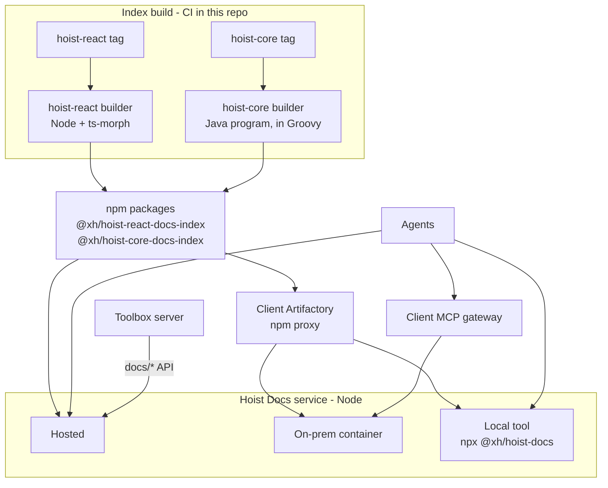

# Hoist Docs: unified MCP server and docs API

Design document. Source of truth while the project is under way; update it as decisions change.

## Summary

Replace the two stdio MCP servers bundled with hoist-react and hoist-core, and the docs backend in
Toolbox, with **Hoist Docs** (this repo): a small TypeScript service that serves an MCP endpoint
for agents and a public docs API for Toolbox's docs viewer, from versioned index files. This repo
also builds those index files, from any tagged release of each library, and publishes them as npm
packages. People keep reading docs in Toolbox, beside the live examples.

- **Why now:** enterprise teams increasingly require MCP servers to run through an MCP gateway.
  Gateways front HTTP endpoints; ours speak only stdio. Bundling also puts six MCP-only packages into every
  Hoist app's dependency tree.
- **What changes:** hoist-react and hoist-core stop shipping any MCP or index code. They keep their
  docs and `docs/doc-registry.json`; everything else lives here.
- **Three deployments, one service:** XH-hosted, an on-prem container behind an organization's gateway,
  and a local tool each developer runs (`npx @xh/hoist-docs`). All three get index files the same
  way, through the npm registry an organization already uses for Hoist.

## Why not a Hoist app

The first version of this repo was a Hoist application (Grails server, hoist-react admin client),
kept at the `grails-prototype` tag. It was dropped because, with every endpoint anonymous, the
Hoist stack carried far more than the service needs:

- The admin console was the main thing Hoist provided, and it needs authentication (it exposes
  configs and logs). Auth0 services, a user domain, a database, Hazelcast and a client build all
  existed only to support it.
- The service is stateless and read-only. A Grails app with a database is a heavy thing to hand a
  client for an on-prem container, and a heavy second app to run locally beside Toolbox.
- Being in Groovy forced a port of hoist-react's TypeScript search, held identical by a parity
  spec. In TypeScript the original search code is reused instead of ported.

Usage visibility moves from the admin console to structured logs (see below). If per-user auth or
an admin UI is needed later, it can be added to this service or fronted by a gateway.

## Components

One repo, three components. Only the service ever runs as a server; the builders are command-line
programs that write a file and exit: a Node program for hoist-react and a Java program for
hoist-core.

| Component | Where | Toolchain | Runs |
| --- | --- | --- | --- |
| **Service** (also the local tool) | `src/` | Node 24; `minisearch` the only runtime dependency | Hosted, on-prem, developers' machines |
| **hoist-react builder** | `builders/react/` (planned) | Node, `ts-morph` | Index build time: CI here, or a developer's machine |
| **hoist-core builder** | `builders/core/` (planned) | A Java program, written in Groovy and run on a JDK; built and launched with a small Gradle build | Index build time: CI here, or a developer's machine |

The JVM is needed only where indexes are built, never where docs are served. The npm package
`@xh/hoist-docs` ships the service alone; builders stay out of it.

## Decisions in force

| Topic | Decision |
| --- | --- |
| Language and runtime | TypeScript on Node 24 LTS, pnpm. Node runs the source directly by stripping types (`node src/server.ts`), so there is no build step or `tsx`; `tsc` only type-checks. Code is limited to erasable syntax (no enums, namespaces or parameter properties). |
| HTTP | Node's built-in `http` server with a small router. No web framework unless one earns its place. |
| MCP | A small hand-written JSON-RPC handler, stateless Streamable HTTP at `/mcp`, ported from the `grails-prototype`. The official SDK (1.32.2) stops at protocol `2025-11-25` and has no `server/discover`, and the handler needs neither it nor `zod`. |
| Search | hoist-react's existing search and formatter code, moved here and adapted to read index files. One ranking for every library, including hoist-core (previously substring search). |
| Index builders | **Live in this repo**, not in the libraries. A builder takes a library checkout at any tag, so a builder fix can be applied to every past release by rebuilding its index. |
| Index publishing | **npm packages**, one per library version: `@xh/hoist-react-docs-index@90.0.0`, `@xh/hoist-core-docs-index@45.0.0`. Organizations already pull `@xh/hoist` through their npm registry or proxy (e.g. Artifactory), so the indexes arrive by a route they already allow. |
| Index compatibility | Indexes hold extracted facts only; interpretation happens in the service. Schema changes are additive by default; a breaking change ships with a load-time migration. See **Compatibility**. |
| Public access | Everything is anonymous: `/mcp` and the read-only `docs/registry`, `docs/content` and `docs/search` API. Per-user MCP auth (MCP OAuth, gateway modes) comes later, if at all. |
| Docs viewer | **Stays in Toolbox**, desktop and mobile, where docs link to live examples and back. Toolbox's server fetches registry, content and search from this service (`hoistDocsUrl` config). |
| API contract | `/mcp` tools and `docs/*` responses keep exactly the shapes the `grails-prototype` served, so Toolbox and agent setups need no change. |
| Configuration | Environment variables only (see below). No database, no instance configs. |
| Usage tracking | One structured JSON log line per MCP call and docs search. |
| Versions | Index per published version plus `develop`; never read Git per query. |
| Local port | `8081` by default, so it runs beside a local Toolbox (8080) and matches Toolbox's documented local `hoistDocsUrl`. |
| Offline | Not a goal. Every deployment fetches indexes through an npm registry, which every Hoist team already reaches. |
| Branches | `develop` in this repo; `hoist-docs` in hoist-react, hoist-core and Toolbox. |
| CLI | `hoist-docs` name kept, as the npm package `@xh/hoist-docs`: `npx @xh/hoist-docs` runs the service locally for the current project. |

## Current state

| Component | Where | Language and size | How it runs | Problems |
| --- | --- | --- | --- | --- |
| hoist-react MCP server and CLIs | `hoist-react/mcp/`, `bin/hoist-mcp.mjs` (removed on the `hoist-docs` branch) | TypeScript, ~11.6k lines incl. tests | stdio, `tsx` executes TS source at runtime | `@modelcontextprotocol/sdk`, `ts-morph`, `tsx`, `zod`, `commander`, `minisearch` are runtime `dependencies` of `@xh/hoist`, used only by `mcp/` and `bin/`. `mcp/` and `bin/` ship in the npm package. |
| hoist-core MCP server and CLIs | `hoist-core/mcp/`, artifact `io.xh:hoist-core-mcp` | Groovy, ~2.6k lines | stdio, fat jar via `mcp/bootstrap.sh` | `bootstrap.sh` downloads jars with `curl --ssl-no-revoke`, no integrity check. MCP Java SDK pulled in Jackson CVEs. Substring search, not ranked. |
| Index builders | `hoist-react/docs-index/` (~3.9k lines TS), `hoist-core/docs-index/` (~1.05k lines Groovy) on the `hoist-docs` branches | TypeScript, Groovy | Run by hand; hoist-react's CI tests its builder, nothing publishes | Each release can only be indexed by the builder as it stood at that release. To move here. |
| Toolbox docs viewer | Toolbox `DocsService`, desktop and mobile UI | Groovy + TS | On the `hoist-docs` branch, calls this service's docs API | None once this service is running. |
| Context7 | `hoist-core/context7.json` | External | Third party | No symbol tools, no ranking control, no visibility. |

## Goals and non-goals

**Goals**

- Serve hoist-react, hoist-core and companion-library docs and symbols over MCP Streamable HTTP so
  any MCP gateway can front it.
- Ship no MCP or index code or dependencies inside `@xh/hoist` or the hoist-core jar.
- One implementation for agents and people, replacing two MCP servers and the Toolbox docs backend.
- Answer for any released version (from hoist-react v83 and hoist-core v37) plus `develop`.
- Reach Hoist teams through the registries they already use, so no new network access is needed.
- Usage visible from the service's logs.
- Keep tool names and output stable so existing agent setups and skills keep working.
- Light to run: one process, one port, fast startup, small container image.

**Non-goals**

- Offline use. Live reading of a developer's uncommitted checkout. Indexing application code. Any
  write operation. An admin UI.

## Architecture

## Index format and build pipeline

One self-contained JSON index per library version. The service only reads these files; it never
parses source. The schema lives in [`index-schema.md`](./index-schema.md).

- **Contents:** header (library, version, git SHA, build time, `schemaVersion`); doc registry
  entries with full markdown; symbols with signatures, docs and members; the member index.
- **Inputs from each library:** its source, its docs, and `docs/doc-registry.json` (each doc's
  title, categories, description, keywords). The registry exists from hoist-react v83 and
  hoist-core v37 (both March 2026); those are the oldest releases indexed.
- **Builders (to move here):** the hoist-react builder (now `hoist-react/docs-index/`) becomes
  `builders/react/`, run with Node; the hoist-core builder (now `hoist-core/docs-index/`) becomes
  `builders/core/`, a Java program written in Groovy (about 1,050 lines), built with Gradle, whose
  only dependencies are `groovy` and `groovy-json`. Each
  takes a library checkout path and writes one index file. Both must understand the source layout
  of every release from the floor above onward; layout changes in a library are handled here.
- **Release flow:** a workflow in this repo notices a new library tag, checks the library out at
  that tag, runs the builder, and publishes the index package. Nothing changes in the libraries'
  own release processes.
- **Packages:** `@xh/hoist-react-docs-index` and `@xh/hoist-core-docs-index`, each holding one
  gzipped index, versioned to match the library release. npm versions are immutable, so a rebuilt
  index for an existing release publishes as a revision (`90.0.0-r2`); consumers take the highest
  revision for a release. `develop` builds publish as prerelease versions under a `develop`
  dist-tag.
- **Backfill:** after a builder fix, rebuild and republish every release from the floor onward.

## Compatibility

Published indexes are permanent: `react-90.0.0` must stay readable as the service changes.

- **Facts, not interpretation.** Indexes hold what is extracted from source: markdown, symbols,
  signatures, members. Everything derived from those is computed by the service at load or query
  time: doc sections, search indexes, ranking, output text, doc id shortcuts. Most changes, from
  ranking tuning to new tools, never touch the index.
- **Additive by default.** A new field is optional, and the service copes when it is missing, as
  it already does for `memberNames` and `hint`. Additive changes keep `schemaVersion`.
- **Breaking changes migrate.** When a format change cannot be additive, `schemaVersion` bumps and
  the service gains a load-time upgrade from the previous version. Migrations stay as long as
  releases indexed under the old schema are supported, so old indexes never need rebuilding to
  keep working.
- **Rebuilding as the fix for extraction gaps.** When a builder misses something (hoist-core's
  member index, see **Testing**), the fix is a builder change plus a backfill, not a service
  workaround.
- **Version pairing.** The service reads every schema version it knows and refuses newer ones with
  a clear error. On-prem images pin their indexes; the local tool and hosted service track the
  latest service release, so they read every published index.

## Versioning

- Selection by optional `version` argument on each tool (or the viewer's version picker); default
  is the newest loaded version. The local tool defaults to the project's own versions, read from
  `package.json` (`@xh/hoist`) and `gradle.properties` (`hoistCoreVersion`).
- Index sources: a local index directory (`INDEX_DIR`, used for dev and baked into on-prem images)
  and, planned, the npm registry. Registry fetches go through npm itself (`npm pack`), so a
  developer's `.npmrc` registry, credentials, proxy and certificates apply unchanged.
- The index directory is rescanned at most every 5 seconds, and a file whose modification time
  changed is reloaded, so a rebuilt or newly added index is served without a restart.

## MCP endpoint and tools

One stateless Streamable HTTP endpoint at `/mcp`, one JSON-RPC message per POST; no sessions.
Supports `initialize` for older clients and `server/discover` for 2026-07-28 clients. Docs are
also served as `hoist://docs/{id}` resources. The local tool may also offer stdio, over the same
handler, for agents that prefer to launch their servers.

| Tool | Arguments | Replaces |
| --- | --- | --- |
| `hoist-search-docs` | `query`, `library`?, `category`?, `limit`?, `version`? | `hoist-search-docs`, `hoist-core-search-docs` |
| `hoist-list-docs` | `library`?, `category`?, `version`? | `hoist-list-docs`, `hoist-core-list-docs` |
| `hoist-read-doc` | `id`, `section`?, `outline`?, `library`?, `version`? | `hoist-read-doc`, `hoist-core-read-doc` |
| `hoist-search-symbols` | `query`, `library`?, `kind`?, `includeInternal`?, `detail`?, `limit`?, `version`? | `hoist-search-symbols`, `hoist-core-search-symbols` |
| `hoist-get-symbol` | `name`, `filePath`?, `kind`?, `library`?, `version`? | `hoist-get-symbol`, `hoist-core-get-symbol` |
| `hoist-get-members` | `name`, `filter`?, `filePath`?, `include`?, `memberKind`?, `detail`?, `library`?, `version`? | `hoist-get-members`, `hoist-core-get-members` |
| `hoist-ping` | none | both pings; reports loaded versions |

- `library` is `react`, `core` or a companion id; omitted, results span all and are labelled.
- `hoist-core-*` names are accepted as aliases (scoped to `core`).
- All tools are annotated read-only.

## Docs API for viewers

Toolbox's desktop and mobile viewers stay in Toolbox, so docs keep their links to live examples.
Toolbox's server calls this service's public docs API:

| Endpoint | Returns |
| --- | --- |
| `GET docs/registry` | Every doc's id, source, title, viewer category, description and keywords, plus each source's categories, loaded version and available versions |
| `GET docs/content?source&docId` | One doc's markdown |
| `GET docs/search?query&limit` | Ranked docs, each once with its best section and an excerpt - the same ranking as `hoist-search-docs` |

Each endpoint takes an optional version per source, as a param named for the source
(`hoist-react=86.2.0`), and an optional `client` param (Toolbox passes `toolbox`) used in usage
logs. Response shapes match the `grails-prototype` `DocsController` exactly.

## Code sources

| Existing code | Fate |
| --- | --- |
| hoist-react `mcp/data/search-text.ts`, `doc-sections.ts` | Moved here unchanged (`src/index/`) from the last hoist-react commit that had them, `788f56b3d` |
| hoist-react `mcp/data/doc-search.ts`, `symbol-search.ts` | Moved here as `DocSearch` and `SymbolSearch`, with the same MiniSearch configuration and tuning, reading index files instead of a live ts-morph registry. Each library has its own search index; results from several libraries merge by score |
| hoist-react `mcp/formatters/`, `doc-id-resolver.ts`, `instructions.ts` | Output shapes kept, via the `grails-prototype` code that had already adapted them to index files (`DocTools`, `SymbolTools`, `DocIdResolver`, `McpService`) |
| `grails-prototype` `DocsController` | Ported as `docs-api.ts`, same response shapes |
| hoist-react `docs-index/` (`ts-registry.ts`, `doc-registry.ts`, `import-paths.ts`, `build-index.ts`) | To move here as `builders/react/`; removed from hoist-react |
| hoist-core `docs-index/` (`GroovyRegistry`, `DocRegistry`, `IndexBuilder`) | To move here as `builders/core/`; removed from hoist-core |
| hoist-react `server.ts`, `resources/`, `bin/hoist-mcp.mjs`, MCP-only dependencies | Removed from hoist-react |
| hoist-core `HoistCoreMcpServer`, `bootstrap.sh`, MCP SDK | Removed from hoist-core |

## Testing

Tests run against small synthetic index files (`test/fixtures.ts`), plus real indexes checked in
under `test/fixtures/indexes` (hoist-react at `788f56b3d`, hoist-core at `279d3e9`, 1.9 MB
gzipped together).

Each library has a golden set (`test/golden/`): realistic queries, each naming the doc sections
or symbols a person would want, with expectations taken from the docs and API rather than from
search output. As in hoist-react's former specs, a case is a hit when an expected result is in the
top 3, each library must reach an 85% hit rate for doc search and for symbol search, and default
search output must stay under a token ceiling. hoist-react's set (79 doc and 82 symbol queries) is
carried over verbatim from its old specs; hoist-core's (50 doc, 59 symbol) is new. Current rates:
hoist-react 97.5% docs, 100% symbols; hoist-core 96.0% docs, 93.2% symbols.

hoist-core's symbol rate is held down by its index, not by search: its builder member-indexes only
17 classes and sets no `memberNames`, so exact method names on services (`withSpan`, `sendEmail`,
`pushToAllChannels`) find at best the owning class. That is the first builder fix to make once the
builders move here, followed by a backfill.

A parity spec checks that search still ranks exactly as hoist-react's did: fixtures in
`test/fixtures/parity` hold hoist-react's results for its golden-set queries, computed against the
checked-in hoist-react index. It runs with every `pnpm test` and matches every doc and symbol
case, scores included.

Once the builders move here, their own specs (hoist-react's builder specs and schema conformance
checks) move with them, and CI builds indexes from the libraries' current `develop` to catch
layout changes early.

## Configuration

| Variable | Default | Meaning |
| --- | --- | --- |
| `PORT` | `8081` | HTTP port. |
| `INDEX_DIR` | `./indexes` | Directory holding `react-<version>.json[.gz]`, `core-<version>.json[.gz]` and companion indexes. |
| `LOG_QUERIES` | `false` | Include query text in usage logs. |
| `LOG_LEVEL` | `info` | `debug` for more detail. |

## Usage visibility

All logging is one JSON object per line. Each MCP call and docs search writes a line with
`msg: "usage"`: `category` (`MCP` / `Docs`), `action` (tool name or `search`), `elapsedMs`,
library, versions, result count, client, and the query arguments only when `LOG_QUERIES` is on.
Hosted, these go to the platform's log collection; on-prem, to the organization's own. The local tool logs
to the developer's terminal only.

## Deployment

- **Local tool:** `npx @xh/hoist-docs` in a Hoist project. Reads the project's Hoist versions,
  fetches those index packages through the developer's npm configuration into a local cache, and
  serves them on localhost (or stdio). Nothing leaves the machine; each developer runs their own.
- **On-prem:** the `Dockerfile` image (`node:24-slim`, source plus production dependencies) with
  the agreed releases' indexes installed at image build time through the organization's registry proxy (e.g. Artifactory), or
  mounted at `/app/indexes`. No database or other services. `GET /health` reports the loaded
  versions.
- **Hosted:** the same image, fetching index packages from npmjs and refreshing `develop`, behind
  XH's usual TLS ingress.
- **Development:** `pnpm dev` on port 8081 beside a local Toolbox, with `hoistDocsUrl` set to
  `http://localhost:8081` in Toolbox's `.env`.

All three deployments run the same service, so an organization can move between them freely: on-prem if
they want it behind their gateway, local if they want no shared service at all.

## Phases

1. Index format and builders in hoist-react and hoist-core (done).
2. Service core: scaffold, index loading, search code moved in, `/mcp` and `docs/*`, tests
   (done).
3. Builders move here, with their specs; hoist-core builder fix for members; index packages
   published from this repo's CI for every release from the floor onward, plus `develop`.
4. Index fetching from the npm registry, and the local tool `@xh/hoist-docs`.
5. On-prem image release.
6. Hosted service.
7. Retire old servers and Context7; remove `docs-index/` from hoist-react and hoist-core.

## Arguments against (summary)

Strongest: XH becomes a service operator; scope beyond what gateway users strictly need. Answered by ordering:
anonymous now, local and on-prem first, measure, then decide on hosting and per-user MCP auth.
Dropping the Hoist stack lowers the operator cost to a stateless container with no database, and
the local tool means hosting is optional rather than required. Owning the builders adds a JVM to
this repo's CI to run the hoist-core builder; it is confined to index build time.

## Open questions

- [ ] What do MCP gateways in use do with caller identity?
- [ ] Do registry proxies in use (e.g. Artifactory) pass the whole `@xh` npm scope, or an allow-list that would
  need the two index packages and `@xh/hoist-docs` added?
- [ ] Hosted at all, or local and on-prem only until demand shows?
- [ ] Make `xh/hoist-docs` public like the other Hoist repos? Not required for the npm packages.
- [ ] How does the release workflow notice new library tags: a scheduled check here (nothing
  needed in the libraries), or a dispatch from each library's release workflow (needs a token
  there)?
- [ ] Should the local tool also offer stdio, or is localhost HTTP enough for the agents in use?
- [ ] Log query text on the hosted service?
- [ ] How many past releases to bake into the on-prem image?
- [ ] Which companion libraries are in scope first?
- [x] Does the MCP SDK support the 2026-07-28 `server/discover` flow? No (1.32.2), so the
  service keeps its own JSON-RPC handler.
