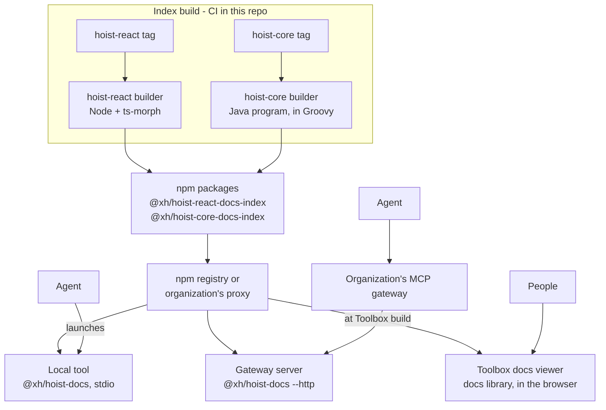

# Hoist Docs: Hoist documentation for agents and people

Design document. Source of truth while the project is under way; update it as decisions change.

## Summary

Replace the two stdio MCP servers bundled with hoist-react and hoist-core, and the docs backend in
Toolbox, with **Hoist Docs** (this repo):

- **A local MCP tool, `@xh/hoist-docs`.** Each Hoist app adds it as a dev dependency. The agent
  launches it over stdio, as it launches today's hoist-react server, and it answers for exactly
  the Hoist versions the app uses.
- **The same program as an HTTP server**, for organizations that front MCP servers with a
  gateway.
- **Versioned index files**, built in this repo from any release of hoist-react and hoist-core and
  published as npm packages, so they reach every team through the registry it already uses.
- **A browser-safe docs library** that Toolbox's docs viewer uses directly, with no server.

XH does not host a service. Everything runs on developers' machines, in Toolbox's browser, or on
an organization's own infrastructure.

- **Why now:** enterprise teams increasingly require MCP servers to run through an MCP gateway.
  Gateways front HTTP endpoints; ours speak only stdio. Bundling also puts six MCP-only packages
  into every Hoist app's dependency tree, and hoist-core's server needs a per-machine launcher for
  a fat jar.
- **What changes in the libraries:** hoist-react and hoist-core stop shipping any MCP or index
  code. They keep their docs and `docs/doc-registry.json`; everything else lives here.

**For an app developer, the change in `.mcp.json`:**

```jsonc
// Today: two servers, one per library; hoist-core's launcher is generated per machine.
{"mcpServers": {
  "hoist-react": {"command": "node", "args": ["client-app/node_modules/@xh/hoist/bin/hoist-mcp.mjs"]},
  "hoist-core": {"command": "./bin/hoist-core-mcp"}
}}

// With Hoist Docs: one server for both libraries, committed once.
{"mcpServers": {
  "hoist": {"command": "node", "args": ["client-app/node_modules/@xh/hoist-docs/bin/hoist-docs.mjs"]}
}}
```

## Why not a Hoist app

The first version of this repo was a Hoist application (Grails server, hoist-react admin client),
kept at the `grails-prototype` tag. It was dropped because, with every endpoint anonymous, the
Hoist stack carried far more than the service needs:

- The admin console was the main thing Hoist provided, and it needs authentication (it exposes
  configs and logs). Auth0 services, a user domain, a database, Hazelcast and a client build all
  existed only to support it.
- The service is stateless and read-only. A Grails app with a database is a heavy thing to run on
  every developer's machine or to hand an organization for its gateway.
- Being in Groovy forced a port of hoist-react's TypeScript search, held identical by a parity
  spec. In TypeScript the original search code is reused instead of ported.

## Components

One repo, four parts. Only the tool ever answers requests; the builders are command-line programs
that write a file and exit.

| Component | Where | Toolchain | Runs |
| --- | --- | --- | --- |
| **MCP tool** (`@xh/hoist-docs`) | `src/` | Node 24; `minisearch` the only runtime dependency | Developers' machines over stdio; an organization's server over HTTP |
| **Docs library** | `@xh/hoist-docs/docs` (`src/docs/`), a browser-safe entry point over the doc-side code in `src/index/` | Plain TypeScript | Toolbox's browser |
| **hoist-react builder** | `builders/react/` | Node, `ts-morph` | Index build time: CI here, or a developer's machine |
| **hoist-core builder** | `builders/core/` | A Java program, written in Groovy and run on a JDK; built and launched with a small Gradle build | Index build time: CI here, or a developer's machine |

The JVM and `ts-morph` are needed only where indexes are built, never where docs are served. The
npm package `@xh/hoist-docs` ships the tool and the docs library; builders stay out of it.

## Decisions in force

| Topic | Decision |
| --- | --- |
| Hosting | **None by XH.** The tool runs locally, or on an organization's own server behind its gateway. |
| Language and runtime | TypeScript on Node 24 LTS, pnpm. In development Node runs the source directly by stripping types, with no `tsx`. Node refuses to strip types inside `node_modules`, so the published package ships JavaScript compiled by `tsc` (`pnpm build`, run on pack); `bin/hoist-docs.mjs` launches it. Code is limited to erasable syntax (no enums, namespaces or parameter properties). |
| Transport | **stdio by default**: the agent launches the tool and talks over stdin and stdout, with no port. **HTTP with `--http`**, for gateways and development. Both use the same handler. In stdio mode all logging goes to stderr. |
| MCP | A small hand-written JSON-RPC handler, ported from the `grails-prototype`. The official SDK (1.32.2) stops at protocol `2025-11-25` and has no `server/discover`, and the handler needs neither it nor `zod`. |
| Installation | **A dev dependency of each app** (`@xh/hoist-docs` in `client-app/package.json`), with `.mcp.json` pointing into `node_modules`. Reproducible through the lockfile, reviewed and installed like every other dependency, no network needed to start it, and the same shape as today's hoist-react entry. `npx @xh/hoist-docs` is documented only for trying it out. |
| Versions | **The local tool serves the app's installed versions, and only those.** HTTP deployments can serve several versions, since one gateway server may front apps on different releases. |
| Search | hoist-react's existing search and formatter code, moved here and adapted to read index files. One ranking for every library, including hoist-core (previously substring search). |
| Index builders | **Live in this repo**, not in the libraries. A builder takes a library checkout at any tag, so a builder fix can be applied to every past release by rebuilding its index. |
| Index publishing | **npm packages**, one per library version: `@xh/hoist-react-docs-index@90.0.0`, `@xh/hoist-core-docs-index@45.0.0`. Organizations already pull `@xh/hoist` through their npm registry or proxy (e.g. Artifactory), so the indexes arrive by a route they already allow. |
| Index compatibility | Indexes hold extracted facts only; interpretation happens in the tool. Schema changes are additive by default; a breaking change ships with a load-time migration. See **Compatibility**. |
| Docs viewer | **Stays in Toolbox**, desktop and mobile, where docs link to live examples and back. Toolbox reads docs directly through the docs library and the index packages for its own Hoist versions; no server is involved. |
| Access | No authentication. Over stdio only the launching agent can reach the tool. Over HTTP, identity is the gateway's concern. |
| Usage tracking | Locally, nothing leaves the machine. Over HTTP, one structured JSON log line per call, for the organization's own log collection. Toolbox tracks docs searches with Hoist's activity tracking. |
| Configuration | Command-line flags and environment variables only. No database. |
| Offline | Not a goal, but once a version's indexes are cached the local tool needs no network. |
| Branches | `develop` in this repo; `hoist-docs` in hoist-react, hoist-core and Toolbox. |

## Current state

| Component | Where | Language and size | How it runs | Problems |
| --- | --- | --- | --- | --- |
| hoist-react MCP server and CLIs | `hoist-react/mcp/`, `bin/hoist-mcp.mjs` (removed on the `hoist-docs` branch) | TypeScript, ~11.6k lines incl. tests | stdio, `tsx` executes TS source at runtime, parsing the installed source with ts-morph | `@modelcontextprotocol/sdk`, `ts-morph`, `tsx`, `zod`, `commander`, `minisearch` are runtime `dependencies` of `@xh/hoist`, used only by `mcp/` and `bin/`. `mcp/` and `bin/` ship in the npm package. |
| hoist-core MCP server and CLIs | `hoist-core/mcp/`, artifact `io.xh:hoist-core-mcp` | Groovy, ~2.6k lines | stdio, fat jar via `mcp/bootstrap.sh` and a per-machine launcher | `bootstrap.sh` downloads jars with `curl --ssl-no-revoke`, no integrity check. MCP Java SDK pulled in Jackson CVEs. Substring search, not ranked. |
| Index builders | Moved here (`builders/`); the originals in `hoist-react/docs-index/` and `hoist-core/docs-index/` remain until phase 7 | TypeScript, Groovy | Run by hand; nothing publishes yet | Relocated builders give byte-identical output to the originals. |
| Toolbox docs viewer | Toolbox `DocsService`, desktop and mobile UI | Groovy + TS | On the `hoist-docs` branch, calls this repo's `docs/*` HTTP API | To read docs directly instead, through `@xh/hoist-docs/docs` and `hoist-docs export-docs` (phase 5). |
| Context7 | `hoist-core/context7.json` | External | Third party | No symbol tools, no ranking control, no visibility. |

## Goals and non-goals

**Goals**

- Serve hoist-react, hoist-core and companion-library docs and symbols to agents, over stdio
  locally and over MCP Streamable HTTP for gateways.
- Ship no MCP or index code or dependencies inside `@xh/hoist` or the hoist-core jar.
- One implementation for agents and people, replacing two MCP servers and Toolbox's docs backend.
- Answer for the versions an app actually uses, for any release from hoist-react v83 and
  hoist-core v37, plus `develop`.
- Reach Hoist teams through the registries they already use, so no new network access is needed.
- Keep tool names and output stable so existing agent setups and skills keep working.
- Light to run: fast startup, no install step beyond the dependency, nothing to keep running.

**Non-goals**

- An XH-hosted service. Live reading of a developer's uncommitted checkout. Indexing application
  code. Any write operation. An admin UI. Central usage reporting.

## Architecture



## Local tool

The primary deployment. An app adds the tool once:

```jsonc
// client-app/package.json
"devDependencies": {"@xh/hoist-docs": "^1.0.0"}

// .mcp.json, at the project root
{"mcpServers": {
  "hoist": {"command": "node", "args": ["client-app/node_modules/@xh/hoist-docs/bin/hoist-docs.mjs"]}
}}
```

The `xh:onboard-app` skill writes both. When the agent starts the tool, it:

1. **Works out the versions** from the project root: the exact installed `@xh/hoist` version (from
   `client-app/node_modules/@xh/hoist/package.json`, not the range in `package.json`) and
   `hoistCoreVersion` from `gradle.properties`. A project with only one of them gets that library
   only.
2. **Gets the indexes**, if not already cached in `~/.cache/hoist-docs`: the two index packages
   for exactly those versions, the highest revision of each. Fetches go through npm itself
   (`npm pack`), so the developer's `.npmrc` registry, credentials, proxy and certificates apply
   unchanged. About 2 MB, once per version.
3. **Serves them over stdio** until the agent session ends. No port is opened.

After a Hoist upgrade, restarting the agent picks up the new versions and fetches their indexes
once. A rebuilt index for the app's version (a builder fix, published as a revision) is picked up
the same way, without upgrading Hoist.

**Snapshot versions.** An app on a `-SNAPSHOT` version, or Toolbox running hoist-react from a
sibling checkout, has no released index. The tool uses the `develop` index, or a local index
directory given with `--index-dir`, for example one built from that checkout with
`pnpm build:react`.

## Gateway deployment

For organizations that front MCP servers with a gateway, the same package runs as an HTTP
server: `hoist-docs --http`, or the `Dockerfile` image (`node:24-slim`). It serves the versions
in its index directory, populated at image build time through the organization's registry proxy
or mounted at `/app/indexes`, and can hold several versions of each library, since one server may
front apps on different releases. Agents then pass `library` and `version` to select one; the
newest is the default.

One stateless endpoint at `/mcp`, one JSON-RPC message per POST, no sessions. `GET /health`
reports the loaded versions. No database or other services. Each call writes one structured JSON
usage line for the organization's log collection.

## Toolbox docs viewer

Toolbox's desktop and mobile viewers stay in Toolbox, so docs keep their links to live examples
and back. They read docs directly, with no server:

- **Data:** Toolbox depends on the index packages for its own Hoist versions. A build step
  extracts the docs part of each into a static asset, loaded when the docs tab opens. The docs
  part is small next to the full index, whose bulk is symbols: hoist-react's is 1.2 MB (371 KB
  gzipped) of an 11.7 MB index, hoist-core's 0.7 MB (210 KB gzipped).
- **Code:** a browser-safe entry point of `@xh/hoist-docs` exports the doc-side code: sections,
  `DocSearch` and doc id resolution. Building the search index takes about 140 ms for hoist-react
  and 80 ms for hoist-core; a query takes a few milliseconds. Ranking is identical to the MCP
  tools', because it is the same code.
- **Versions:** the viewer covers the versions Toolbox runs, which matches the live examples
  beside it. During Toolbox development, docs can come from the sibling hoist-react checkout, so
  doc edits show up as they are written.
- **Tracking:** docs searches are tracked with Hoist's activity tracking, like the rest of
  Toolbox.

In this repo, the docs library is `@xh/hoist-docs/docs`: `DocsCatalog` takes one docs payload per
library and answers `registry()`, `content(source, docId)` and `search(query, limit)` with the
shapes of the former `docs/*` HTTP API, so Toolbox's viewer code changes little. A spec checks
that its answers equal the HTTP API's, and that nothing it imports reaches Node. The payloads come
from `hoist-docs export-docs --out <dir>`, run in Toolbox's build: it resolves Toolbox's own Hoist
versions as the local tool does, and writes `<dir>/react.json`, `<dir>/core.json` and an
`index.json` listing them.

Toolbox's server-side `DocsService` goes away, and so does this repo's `docs/*` HTTP API, which
exists only for it.

## Index format and build pipeline

One self-contained JSON index per library version. The tool only reads these files; it never
parses source. The schema lives in [`index-schema.md`](./index-schema.md).

- **Contents:** header (library, version, git SHA, build time, `schemaVersion`); doc registry
  entries with full markdown; symbols with signatures, docs and members; the member index.
- **Inputs from each library:** its source, its docs, and `docs/doc-registry.json` (each doc's
  title, categories, description, keywords). The registry exists from hoist-react v83 and
  hoist-core v37 (both March 2026); those are the oldest releases indexed.
- **Builders:** `builders/react/` (`pnpm build:react`), run with Node and `ts-morph`; and
  `builders/core/` (`pnpm build:core`), a Java program written in Groovy (about 1,050 lines),
  built with Gradle, whose only dependencies are `groovy` and `groovy-json`. Each takes
  `--root <checkout>` and `--version <v>` and writes one index file. For the same checkout, each
  writes exactly what the original in-library builder wrote, apart from the build time.
- **What building a tag needs:**
  - The version comes from the tag, not the checkout. Tagged commits carry the *next* snapshot
    version (hoist-react's v89.3.1 tag says `90.0.0-SNAPSHOT`; hoist-core's v44.0.0 says
    `44.0-SNAPSHOT`), the release version being set at publish time.
  - hoist-react needs its dependencies installed at that tag, for type resolution, with the
    package manager the tag declares: Yarn through v86, pnpm later (`corepack` picks it).
    hoist-core needs no install; its builder reads source files only.
  - Both must understand the source layout of every release from the floor onward. Releases
    before the move carry the old `mcp/` server source, which the hoist-react builder excludes
    (the hoist-core builder reads only its source folders). Checked by building hoist-react
    v83.0.0 and hoist-core v37.0.0, the oldest in range, with today's builders.
- **Release flow:** `.github/workflows/publish-indexes.yml` runs `scripts/publish-indexes.ts`
  daily: for each release tag from the floor with no published index, it checks the library out
  at the tag in a git worktree, installs (hoist-react only), runs the builder with the tag's
  version, packs the index (`scripts/pack-index.ts`) and publishes it; then the same for
  `develop` if its head changed. Run by hand, it takes specific tags, rebuilds them as new
  revisions, or does a dry run that builds and packs without publishing. Nothing changes in the
  libraries' own release processes.
- **Publishing needs:** npm trusted publishing (OIDC), as hoist-react's releases use, with a
  trusted publisher configured on npmjs.com for each index package; and the
  `FONTAWESOME_PACKAGE_TOKEN` secret, since installing any hoist-react release pulls Font Awesome
  Pro from its private registry. The dist-tag `latest` only moves forward; older releases
  published later get `backfill`.
- **Packages:** `@xh/hoist-react-docs-index` and `@xh/hoist-core-docs-index`, each holding one
  gzipped index, versioned to match the library release. npm versions are immutable, so a rebuilt
  index for an existing release publishes as a revision (`90.0.0-r2`); consumers take the highest
  revision for a release. `develop` builds publish as prerelease versions under a `develop`
  dist-tag.
- **Backfill:** after a builder fix, rebuild and republish every release from the floor onward.

## Compatibility

Published indexes are permanent: `react-90.0.0` must stay readable as the tool changes.

- **Facts, not interpretation.** Indexes hold what is extracted from source: markdown, symbols,
  signatures, members. Everything derived from those is computed by the tool at load or query
  time: doc sections, search indexes, ranking, output text, doc id shortcuts. Most changes, from
  ranking tuning to new tools, never touch the index.
- **Additive by default.** A new field is optional, and the tool copes when it is missing, as it
  already does for `memberNames` and `hint`. Additive changes keep `schemaVersion`.
- **Breaking changes migrate.** When a format change cannot be additive, `schemaVersion` bumps and
  the tool gains a load-time upgrade from the previous version. Migrations stay as long as
  releases indexed under the old schema are supported, so old indexes never need rebuilding to
  keep working.
- **Rebuilding as the fix for extraction gaps.** When a builder misses something (hoist-core's
  member index, see **Testing**), the fix is a builder change plus a backfill, not a tool
  workaround.
- **Tool and Hoist versions.** Apps pin the tool through their lockfile, so an old tool can meet
  an index from a newer Hoist release. The tool reads every schema version it knows and refuses a
  newer one with a clear "upgrade `@xh/hoist-docs`" message. A Hoist release that needs a newer
  tool says so in its upgrade notes, with the minimum version.

## MCP tools

Seven read-only tools, with the names and output of the stdio servers they replace. Docs are also
served as `hoist://docs/{id}` resources. Supports `initialize` for older clients and
`server/discover` for 2026-07-28 clients.

| Tool | Arguments | Replaces |
| --- | --- | --- |
| `hoist-search-docs` | `query`, `library`?, `category`?, `limit`?, `version`? | `hoist-search-docs`, `hoist-core-search-docs` |
| `hoist-list-docs` | `library`?, `category`?, `version`? | `hoist-list-docs`, `hoist-core-list-docs` |
| `hoist-read-doc` | `id`, `section`?, `outline`?, `library`?, `version`? | `hoist-read-doc`, `hoist-core-read-doc` |
| `hoist-search-symbols` | `query`, `library`?, `kind`?, `includeInternal`?, `detail`?, `limit`?, `version`? | `hoist-search-symbols`, `hoist-core-search-symbols` |
| `hoist-get-symbol` | `name`, `filePath`?, `kind`?, `library`?, `version`? | `hoist-get-symbol`, `hoist-core-get-symbol` |
| `hoist-get-members` | `name`, `filter`?, `filePath`?, `include`?, `memberKind`?, `detail`?, `library`?, `version`? | `hoist-get-members`, `hoist-core-get-members` |
| `hoist-ping` | none | both pings; reports loaded versions |

- `library` is `react`, `core` or a companion id; omitted, results span all and are labelled.
- `version` matters only on a multi-version gateway server. The local tool has one version per
  library, and its instructions do not ask the agent to choose.
- `hoist-core-*` names are accepted as aliases (scoped to `core`).

## Code sources

| Existing code | Fate |
| --- | --- |
| hoist-react `mcp/data/search-text.ts`, `doc-sections.ts` | Moved here unchanged (`src/index/`) from the last hoist-react commit that had them, `788f56b3d` |
| hoist-react `mcp/data/doc-search.ts`, `symbol-search.ts` | Moved here as `DocSearch` and `SymbolSearch`, with the same MiniSearch configuration and tuning, reading index files instead of a live ts-morph registry. Each library has its own search index; results from several libraries merge by score |
| hoist-react `mcp/formatters/`, `doc-id-resolver.ts`, `instructions.ts` | Output shapes kept, via the `grails-prototype` code that had already adapted them to index files (`DocTools`, `SymbolTools`, `DocIdResolver`, `McpService`) |
| `grails-prototype` `DocsController` | Ported as `docs-api.ts`; to be removed once Toolbox reads docs directly |
| hoist-react `docs-index/` (`ts-registry.ts`, `doc-registry.ts`, `import-paths.ts`, `build-index.ts`) | Moved here as `builders/react/`, taking the checkout as an argument; to be removed from hoist-react in phase 7 |
| hoist-core `docs-index/` (`GroovyRegistry`, `DocRegistry`, `IndexBuilder`) | Moved here as `builders/core/`, with its own Gradle build; to be removed from hoist-core in phase 7 |
| hoist-react `server.ts`, `resources/`, `bin/hoist-mcp.mjs`, MCP-only dependencies | Removed from hoist-react |
| hoist-core `HoistCoreMcpServer`, `bootstrap.sh`, MCP SDK | Removed from hoist-core |

## Testing

Tests run against small synthetic index files (`test/fixtures.ts`), plus real indexes checked in
under `test/fixtures/indexes` (hoist-react at `788f56b3d`, hoist-core at `279d3e9`, 1.9 MB
gzipped together).

Each library has a golden set (`test/golden/`): realistic queries, each naming the doc sections
or symbols a person would want, with expectations taken from the docs and API rather than from
search output. As in hoist-react's former specs, a case is a hit when an expected result is in the
top 3, each library must reach an 85% hit rate for doc search and for symbol search, and default
search output must stay under a token ceiling. hoist-react's set (79 doc and 82 symbol queries) is
carried over verbatim from its old specs; hoist-core's (50 doc, 59 symbol) is new. Current rates:
hoist-react 97.5% docs, 100% symbols; hoist-core 96.0% docs, 98.3% symbols.

The hoist-core builder used to member-index a curated 17 classes and set no `memberNames`, so exact
method names on services (`withSpan`, `sendEmail`, `pushToAllChannels`) found at best the owning
class, and hoist-core symbol search scored 93.2%. It now indexes the non-private members of every
type, as hoist-react's does, and records each symbol's own member names, minus those of the base
types most classes extend (`BaseService`, `BaseController`, `LogSupport`, `IdentitySupport`).
Protected members are included: they are the API apps use from their own subclasses
(`BaseController.renderJSON`). hoist-core symbol search now scores 98.3%, and the member cases
run without an owning-class fallback. Published indexes for past releases get the fix through a
backfill.

A parity spec checks that search still ranks exactly as hoist-react's did: fixtures in
`test/fixtures/parity` hold hoist-react's results for its golden-set queries, computed against the
checked-in hoist-react index. It runs with every `pnpm test` and matches every doc and symbol
case, scores included.

The builders' specs moved with them: hoist-react's import-path spec always runs, and its schema
conformance spec runs when `HOIST_REACT_ROOT` names a checkout with dependencies installed. CI is
to build indexes from the libraries' current `develop` to catch layout changes early. The stdio
transport gets a spec that launches the tool and makes calls over stdin and stdout.

## Configuration

| Setting | Default | Meaning |
| --- | --- | --- |
| `--http` | off | Serve HTTP instead of stdio. |
| `--project` | current directory | The project whose Hoist versions the local tool serves. |
| `PORT` / `--port` | `8081` | HTTP port. |
| `INDEX_DIR` / `--index-dir` | Local tool: the cache, filled for the project's versions. HTTP: `./indexes` | Directory holding `react-<version>.json[.gz]`, `core-<version>.json[.gz]` and companion indexes. Given explicitly, the tool serves what is there and fetches nothing. |
| `HOIST_DOCS_CACHE` | `~/.cache/hoist-docs` (`%LOCALAPPDATA%\hoist-docs\cache` on Windows) | Where the local tool keeps fetched indexes. |
| `LOG_QUERIES` | `false` | Include query text in usage log lines. |
| `LOG_LEVEL` | `info` | `debug` for more detail. |

## Phases

1. Index format and builders in hoist-react and hoist-core (done).
2. Tool core: scaffold, index loading, search code moved in, MCP over HTTP, tests (done).
3. Builders move here, with their specs (done); hoist-core builder fix for members (done); index
   publishing workflow and scripts (done, verified by dry runs for hoist-react v90.0.0,
   hoist-core v44.0.0 and hoist-core `develop`). To go live: trusted publishers on npmjs.com, the
   Font Awesome secret, then a first run to publish every release from the floor.
4. Local tool: stdio transport (the default), version detection, index fetching through npm and
   the cache, packaging and the release workflow (done, verified by installing the packed package
   into an app and running it through `.mcp.json`'s path against real index packages). To go
   live: the first `@xh/hoist-docs` release; `xh:onboard-app` writes the dev dependency and
   `.mcp.json`.
5. Toolbox reads docs directly: the docs library and `export-docs` (done); Toolbox's build step
   and viewer change, and removal of Toolbox's `DocsService` and of this repo's `docs/*` API.
6. Gateway deployment documented and released (`--http`, the image).
7. Retire the old servers and Context7; remove `docs-index/` from hoist-react and hoist-core.

## Arguments against (summary)

- **No central view of usage.** Without a hosted service XH cannot see how agents use the docs.
  Accepted: gateway deployments log usage for their organizations, and Toolbox tracks docs
  searches with Hoist's activity tracking.
- **A new dependency in every app.** Small (one runtime dependency of its own) and dev-only; it
  replaces the six MCP-only packages that `@xh/hoist` carries today.
- **A JVM in this repo's CI**, to run the hoist-core builder. Confined to index build time.
- **Index publishing becomes a release dependency.** Toolbox, and any app wanting docs for a new
  release, waits for that release's index package. The release workflow keeps this to minutes.

## Open questions

- [ ] What do MCP gateways in use do with caller identity?
- [ ] Do registry proxies in use (e.g. Artifactory) pass the whole `@xh` npm scope, or an
  allow-list that would need `@xh/hoist-docs` and the two index packages added?
- [ ] How does the release workflow notice new library tags: a scheduled check here (nothing
  needed in the libraries), or a dispatch from each library's release workflow (needs a token
  there)?
- [ ] Final package names. npm trusted publishing must be set up per package; whether that is
  possible before a package's first publish, or needs a one-time token publish, to be checked.
- [ ] Toolbox's viewer: only the versions Toolbox runs, or a few past releases too?
- [ ] Snapshot versions in the local tool: the `develop` index, or detect a sibling checkout and
  prefer a local build?
- [ ] If gateway deployments turn out to be per-developer too, drop multi-version support?
- [ ] Which companion libraries are in scope first?
- [x] Hosted by XH? No.
- [x] Make `xh/hoist-docs` public? Yes, done.
- [x] Local tool transport? stdio by default, HTTP opt-in.
- [x] Local tool installation? A dev dependency of each app.
- [x] Does the MCP SDK support the 2026-07-28 `server/discover` flow? No (1.32.2), so the tool
  keeps its own JSON-RPC handler.
