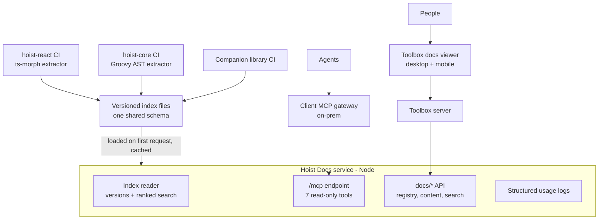

# Hoist Docs: unified MCP server and docs API

Design document. Source of truth while the project is under way; update it as decisions change.
Original draft and discussion: https://claude.ai/artifact/UAw4RnTApjAJTuCjJiRuyN

## Summary

Replace the two stdio MCP servers bundled with hoist-react and hoist-core, and the docs backend in
Toolbox, with one small TypeScript service: **Hoist Docs** (this repo). It serves an MCP endpoint
for agents and a public docs API for Toolbox's docs viewer, both from versioned indexes built in
each library's CI. People keep reading docs in Toolbox, beside the live examples.

- **Why now:** an important client requires MCP servers to run through their gateway. Gateways
  front HTTP endpoints; ours speak only stdio. Bundling also puts six MCP-only packages into every
  Hoist app's dependency tree.
- **What changes:** hoist-react and hoist-core stop shipping any MCP runtime code. Each repo keeps
  only an index builder that runs in CI.
- **Two deployments, one codebase:** XH-hosted and an on-prem container behind the client's
  gateway.

## Why not a Hoist app

The first version of this repo was a Hoist application (Grails server, hoist-react admin client),
kept at the `grails-prototype` tag. It was dropped because, with every endpoint anonymous, the
Hoist stack carried far more than the service needs:

- The admin console was the main thing Hoist provided, and it needs authentication (it exposes
  configs and logs). Auth0 services, a user domain, a database, Hazelcast and a client build all
  existed only to support it.
- The service is stateless and read-only. A Grails app with a database is a heavy thing to hand a
  client for an on-prem container, and a heavy second app to run locally beside Toolbox.
- Being in Groovy forced a port of hoist-react's TypeScript search, held identical by a parity
  spec. In TypeScript the original search code is reused instead of ported.

Usage visibility moves from the admin console to structured logs (see below). If per-user auth or
an admin UI is needed later, it can be added to this service or fronted by a gateway.

## Decisions in force

| Topic | Decision |
| --- | --- |
| Language and runtime | TypeScript on Node 24 LTS, pnpm. Node runs the source directly by stripping types (`node src/server.ts`), so there is no build step or `tsx`; `tsc` only type-checks. Code is limited to erasable syntax (no enums, namespaces or parameter properties). |
| HTTP | Node's built-in `http` server with a small router. No web framework unless one earns its place. |
| MCP | A small hand-written JSON-RPC handler, stateless Streamable HTTP at `/mcp`, ported from the `grails-prototype`. The official SDK (1.32.2) stops at protocol `2025-11-25` and has no `server/discover`, and the handler needs neither it nor `zod`. Only runtime dependency: `minisearch`. |
| Search | hoist-react's existing search and formatter code, moved here and adapted to read index files. One ranking for every library, including hoist-core (previously substring search). |
| Public access | Everything is anonymous: `/mcp` and the read-only `docs/registry`, `docs/content` and `docs/search` API. Per-user MCP auth (MCP OAuth, gateway modes) comes later, if at all. |
| Docs viewer | **Stays in Toolbox**, desktop and mobile, where docs link to live examples and back. Toolbox's server fetches registry, content and search from this service (`hoistDocsUrl` config). |
| API contract | `/mcp` tools and `docs/*` responses keep exactly the shapes the `grails-prototype` served, so Toolbox and agent setups need no change. |
| Configuration | Environment variables only (see below). No database, no instance configs. |
| Usage tracking | One structured JSON log line per MCP call and docs search. |
| Versions | Index per published version plus `develop`; never read Git per query. |
| Local port | `8081` by default, so it runs beside a local Toolbox (8080) and matches Toolbox's documented local `hoistDocsUrl`. |
| Offline | Not supported, not needed. |
| Branches | `develop` in this repo; `hoist-docs` in hoist-react, hoist-core and Toolbox. |
| CLI | `hoist-docs` CLI name kept; becomes a thin client of this service when the old servers retire. |

## Current state

| Component | Where | Language and size | How it runs | Problems |
| --- | --- | --- | --- | --- |
| hoist-react MCP server and CLIs | `hoist-react/mcp/`, `bin/hoist-mcp.mjs` (removed on the `hoist-docs` branch) | TypeScript, ~11.6k lines incl. tests | stdio, `tsx` executes TS source at runtime | `@modelcontextprotocol/sdk`, `ts-morph`, `tsx`, `zod`, `commander`, `minisearch` are runtime `dependencies` of `@xh/hoist`, used only by `mcp/` and `bin/`. `mcp/` and `bin/` ship in the npm package. |
| hoist-core MCP server and CLIs | `hoist-core/mcp/`, artifact `io.xh:hoist-core-mcp` | Groovy, ~2.6k lines | stdio, fat jar via `mcp/bootstrap.sh` | `bootstrap.sh` downloads jars with `curl --ssl-no-revoke`, no integrity check. MCP Java SDK pulled in Jackson CVEs. Substring search, not ranked. |
| Toolbox docs viewer | Toolbox `DocsService`, desktop and mobile UI | Groovy + TS | On the `hoist-docs` branch, calls this service's docs API | None once this service is running. |
| Context7 | `hoist-core/context7.json` | External | Third party | No symbol tools, no ranking control, no visibility. |

## Goals and non-goals

**Goals**

- Serve hoist-react, hoist-core and companion-library docs and symbols over MCP Streamable HTTP so
  any MCP gateway can front it.
- Ship no MCP runtime code or dependencies inside `@xh/hoist` or the hoist-core jar.
- One implementation for agents and people, replacing two MCP servers and the Toolbox docs backend.
- Answer for any released version plus `develop`.
- Usage visible from the service's logs.
- Keep tool names and output stable so existing agent setups and skills keep working.
- Light to run: one process, one port, fast startup, small container image.

**Non-goals**

- Offline use. Live reading of a developer's uncommitted checkout. Indexing application code. Any
  write operation. An admin UI.

## Architecture

## Index format and build pipeline

Each library builds one self-contained JSON index per release in CI, with its own toolchain. The
service only reads these files; it never parses source. The schema lives in
[`index-schema.md`](./index-schema.md).

- **Contents:** header (library, version, git SHA, build time, `schemaVersion`); doc registry
  entries; doc markdown and sections; symbols; members; precomputed symbol details.
- **Builders:** hoist-react `pnpm build:index` (`docs-index/`); hoist-core Gradle task
  `:docs-index:buildIndex`.
- **Publishing:** attached to GitHub releases and published with the library; `develop` rebuilt on
  push. `schemaVersion` checked on load.

## Versioning

- Selection by optional `version` argument on each tool (or the viewer's version picker); default
  is the newest loaded version.
- Index sources, in order: a local index directory (`INDEX_DIR`, used for dev and on-prem), then
  GitHub release assets (hosted).
- The index directory is rescanned at most every 5 seconds, and a file whose modification time
  changed is reloaded, so a rebuilt or newly added index is served without a restart.
- Fetching release assets from GitHub, with `develop` re-fetched on a timer, comes with the hosted
  service (phase 4).

## MCP endpoint and tools

One stateless Streamable HTTP endpoint at `/mcp`, one JSON-RPC message per POST; no sessions.
Supports `initialize` for older clients and `server/discover` for 2026-07-28 clients. Docs are
also served as `hoist://docs/{id}` resources.

| Tool | Arguments | Replaces |
| --- | --- | --- |
| `hoist-search-docs` | `query`, `library`?, `category`?, `limit`?, `version`? | `hoist-search-docs`, `hoist-core-search-docs` |
| `hoist-list-docs` | `library`?, `category`?, `version`? | `hoist-list-docs`, `hoist-core-list-docs` |
| `hoist-read-doc` | `id`, `section`?, `outline`?, `library`?, `version`? | `hoist-read-doc`, `hoist-core-read-doc` |
| `hoist-search-symbols` | `query`, `library`?, `kind`?, `includeInternal`?, `detail`?, `limit`?, `version`? | `hoist-search-symbols`, `hoist-core-search-symbols` |
| `hoist-get-symbol` | `name`, `filePath`?, `kind`?, `library`?, `version`? | `hoist-get-symbol`, `hoist-core-get-symbol` |
| `hoist-get-members` | `name`, `filter`?, `filePath`?, `include`?, `memberKind`?, `detail`?, `library`?, `version`? | `hoist-get-members`, `hoist-core-get-members` |
| `hoist-ping` | none | both pings; reports loaded versions |

- `library` is `react`, `core` or a companion id; omitted, results span all and are labelled.
- `hoist-core-*` names are accepted as aliases (scoped to `core`).
- All tools are annotated read-only.

## Docs API for viewers

Toolbox's desktop and mobile viewers stay in Toolbox, so docs keep their links to live examples.
Toolbox's server calls this service's public docs API:

| Endpoint | Returns |
| --- | --- |
| `GET docs/registry` | Every doc's id, source, title, viewer category, description and keywords, plus each source's categories, loaded version and available versions |
| `GET docs/content?source&docId` | One doc's markdown |
| `GET docs/search?query&limit` | Ranked docs, each once with its best section and an excerpt - the same ranking as `hoist-search-docs` |

Each endpoint takes an optional version per source, as a param named for the source
(`hoist-react=86.2.0`), and an optional `client` param (Toolbox passes `toolbox`) used in usage
logs. Response shapes match the `grails-prototype` `DocsController` exactly.

## Code sources

| Existing code | Fate |
| --- | --- |
| hoist-react `mcp/data/search-text.ts`, `doc-sections.ts` | Moved here unchanged (`src/index/`) from the last hoist-react commit that had them, `788f56b3d` |
| hoist-react `mcp/data/doc-search.ts`, `symbol-search.ts` | Moved here as `DocSearch` and `SymbolSearch`, with the same MiniSearch configuration and tuning, reading index files instead of a live ts-morph registry. Each library has its own search index; results from several libraries merge by score |
| hoist-react `mcp/formatters/`, `doc-id-resolver.ts`, `instructions.ts` | Output shapes kept, via the `grails-prototype` code that had already adapted them to index files (`DocTools`, `SymbolTools`, `DocIdResolver`, `McpService`) |
| `grails-prototype` `DocsController` | Ported as `docs-api.ts`, same response shapes |
| hoist-react `docs-index/` (`ts-registry.ts`, `doc-registry.ts`, `import-paths.ts`) | Stays in hoist-react as the index builder |
| hoist-core `GroovyRegistry`, `DocRegistry` | Stay in hoist-core as the index builder |
| hoist-react `server.ts`, `resources/`, `bin/hoist-mcp.mjs`, MCP-only dependencies | Removed from hoist-react |
| hoist-core `HoistCoreMcpServer`, `bootstrap.sh`, MCP SDK | Removed from hoist-core |

Tests run against small synthetic index files (`test/fixtures.ts`), plus real indexes checked in
under `test/fixtures/indexes` (hoist-react at `788f56b3d`, hoist-core at `279d3e9`, 1.9 MB
gzipped together).

Each library has a golden set (`test/golden/`): realistic queries, each naming the doc sections
or symbols a person would want, with expectations taken from the docs and API rather than from
search output. As in hoist-react's former specs, a case is a hit when an expected result is in the
top 3, each library must reach an 85% hit rate for doc search and for symbol search, and default
search output must stay under a token ceiling. hoist-react's set (79 doc and 82 symbol queries) is
carried over verbatim from its old specs; hoist-core's (50 doc, 59 symbol) is new. Current rates:
hoist-react 97.5% docs, 100% symbols; hoist-core 96.0% docs, 93.2% symbols.

hoist-core's symbol rate is held down by its index, not by search: the builder member-indexes only
17 classes and sets no `memberNames`, so exact method names on services (`withSpan`,
`sendEmail`, `pushToAllChannels`) find at best the owning class. Fixing that belongs in
hoist-core's `docs-index` builder.

A parity spec checks that
search still ranks exactly as hoist-react's did: fixtures in `test/fixtures/parity` hold
hoist-react's results for its golden-set queries, computed against the checked-in hoist-react
index. It runs with every `pnpm test` and matches every doc and
symbol case, scores included.

## Configuration

| Variable | Default | Meaning |
| --- | --- | --- |
| `PORT` | `8081` | HTTP port. |
| `INDEX_DIR` | `./indexes` | Directory holding `react-<version>.json[.gz]`, `core-<version>.json[.gz]` and companion indexes. |
| `LOG_QUERIES` | `false` | Include query text in usage logs. |
| `LOG_LEVEL` | `info` | `debug` for more detail. |

## Usage visibility

All logging is one JSON object per line. Each MCP call and docs search writes a line with
`msg: "usage"`: `category` (`MCP` / `Docs`), `action` (tool name or `search`), `elapsedMs`,
library, versions, result count, client, and the query arguments only when `LOG_QUERIES` is on. Hosted, these go to the platform's log collection; on-prem, to the client's.

## Deployment

- **On-prem:** the `Dockerfile` image (`node:24-slim`, source plus production dependencies) with
  the indexes for the agreed releases baked in under `/app/indexes` by a derived image, or mounted
  there. No database or other services. `GET /health` reports the loaded versions.
- **Hosted:** the same image, fetching release assets from GitHub, behind XH's usual TLS ingress.
- **Local:** `pnpm dev` on port 8081 beside a local Toolbox, with `hoistDocsUrl` set to
  `http://localhost:8081` in Toolbox's `.env`.

## Phases

1. Index format and builders (done in hoist-react and hoist-core).
2. Service core: scaffold, index loading, search code moved in, `/mcp` and `docs/*`, tests
   (done).
3. On-prem release: container image with baked indexes.
4. Hosted service.
5. Retire old servers and Context7.

## Arguments against (summary)

Strongest: XH becomes a service operator; scope beyond the client's ask. Answered by ordering:
on-prem first, anonymous now, measure, then decide on hosting and per-user MCP auth. Dropping the
Hoist stack also lowers the operator cost: a stateless container with no database. Full table in
the original draft.

## Open questions

- [ ] What exactly does the client's gateway do with identity?
- [ ] Hosted at all, or on-prem only until demand shows?
- [ ] Log query text on the hosted service?
- [ ] How many past releases to bake into the on-prem image?
- [ ] Which companion libraries are in scope first?
- [x] Does the MCP SDK support the 2026-07-28 `server/discover` flow? No (1.32.2), so the
  service keeps its own JSON-RPC handler.
