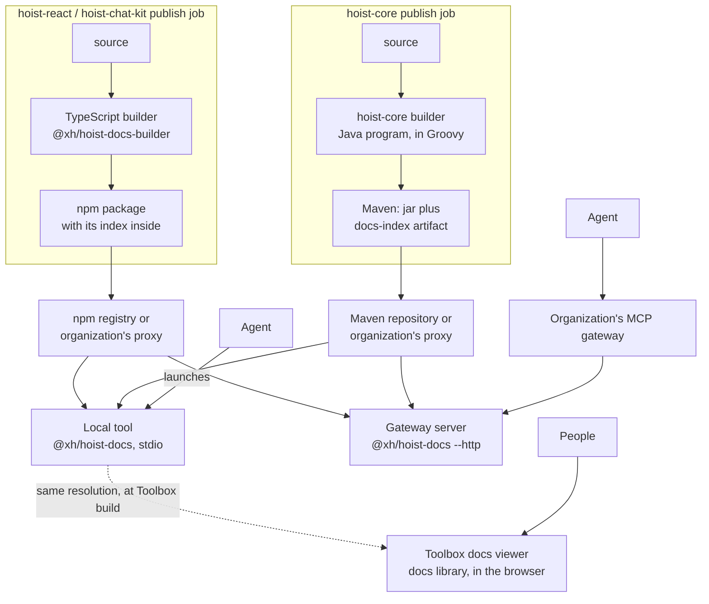

# Hoist Docs: Hoist documentation for agents and people

Design document. Source of truth while the project is under way; update it as decisions change.

## Summary

Replace the two stdio MCP servers bundled with hoist-react and hoist-core, and the docs backend in
Toolbox, with **Hoist Docs** (this repo):

- **A local MCP tool, `@xh/hoist-docs`.** Each Hoist app adds it as a dev dependency. The agent
  launches it over stdio, as it launches today's hoist-react server, and it answers for exactly
  the Hoist versions the app uses.
- **The same program as an HTTP server**, for organizations that front MCP servers with a
  gateway.
- **Versioned index files that ship with their library.** Each library builds its index in its own
  publish job and ships it the way it ships itself: inside the npm package for hoist-react and the
  other TypeScript libraries, as an extra Maven artifact beside the jar for hoist-core. An index is
  always exactly the installed version, snapshots included, and reaches every team through the
  registry it already uses for the library.
- **A browser-safe docs library** that Toolbox's docs viewer uses directly, with no server.

XH does not host a service. Everything runs on developers' machines, in Toolbox's browser, or on
an organization's own infrastructure.

- **Why now:** enterprise teams increasingly require MCP servers to run through an MCP gateway.
  Gateways front HTTP endpoints; ours speak only stdio. Bundling also puts six MCP-only packages
  into every Hoist app's dependency tree, and hoist-core's server needs a per-machine launcher for
  a fat jar.
- **What changes in the libraries:** hoist-react and hoist-core stop shipping any MCP or index
  code. They keep their docs and `docs/doc-registry.json`, and their publish jobs gain one step
  that builds the index with this repo's builder and ships it as data. The tool, the search and the
  builders live here.

**For an app developer, the change in `.mcp.json`:**

```jsonc
// Today: two servers, one per library; hoist-core's launcher is generated per machine.
{"mcpServers": {
  "hoist-react": {"command": "node", "args": ["client-app/node_modules/@xh/hoist/bin/hoist-mcp.mjs"]},
  "hoist-core": {"command": "./bin/hoist-core-mcp"}
}}

// With Hoist Docs: one server for both libraries, committed once.
{"mcpServers": {
  "hoist-docs": {"command": "node", "args": ["client-app/node_modules/@xh/hoist-docs/bin/hoist-docs.mjs"]}
}}
```

## Components

One repo, four parts. Only the tool ever answers requests; the builders are command-line programs
that write a file and exit.

| Component | Where | Toolchain | Runs |
| --- | --- | --- | --- |
| **MCP tool** (`@xh/hoist-docs`) | `src/` | Node 24; runtime dependencies `@modelcontextprotocol/server` (MCP SDK v2) and `minisearch` | Developers' machines over stdio; an organization's server over HTTP |
| **Docs library** | `@xh/hoist-docs/docs` (`src/docs/`), a browser-safe entry point over the doc-side code in `src/index/` | Plain TypeScript | Toolbox's browser |
| **TypeScript builder** | `builders/react/`, published as `@xh/hoist-docs-builder` | Node, `ts-morph` | Each TypeScript library's own publish job, or a developer's machine. Builds hoist-react, and the other TypeScript libraries with `--library` |
| **Grails builder** | `builders/core/`, published to Maven Central as `io.xh:hoist-docs-builder` | A Java program, written in Groovy and run on a JDK; built and launched with a small Gradle build | hoist-core's own build (and any Grails library's), or a developer's machine |

The JVM and `ts-morph` are needed only where indexes are built, never where docs are served. The
npm package `@xh/hoist-docs` ships the tool and the docs library; builders stay out of it.

## Decisions in force

| Topic | Decision |
| --- | --- |
| Hosting | **None by XH.** The tool runs locally, or on an organization's own server behind its gateway. |
| Language and runtime | TypeScript on Node 24 LTS, pnpm. In development Node runs the source directly by stripping types, with no `tsx`. Node refuses to strip types inside `node_modules`, so the published package ships JavaScript compiled by `tsc` (`pnpm build`, run on pack); `bin/hoist-docs.mjs` launches it. Code is limited to erasable syntax (no enums, namespaces or parameter properties). |
| Transport | **stdio by default**: the agent launches the tool and talks over stdin and stdout, with no port. **HTTP with `--http`**, for gateways and development. Both serve the same server factory, through the SDK's `serveStdio` and `createMcpHandler`. In stdio mode all logging goes to stderr. |
| MCP | **The official MCP TypeScript SDK v2** (`@modelcontextprotocol/server`), which implements the **2026-07-28 spec** - stateless serving and `server/discover` - and still serves 2025-era clients through the `initialize` handshake (stateless over HTTP). v2 is published as separate packages; the single `@modelcontextprotocol/sdk` package is the v1 line, which stops at `2025-11-25`. The SDK owns protocol compliance, input validation against each tool's JSON Schema, and the transports; this repo owns the tools. |
| Installation | **A dev dependency of each app** (`@xh/hoist-docs` in `client-app/package.json`), with `.mcp.json` pointing into `node_modules`. Reproducible through the lockfile, reviewed and installed like every other dependency, no network needed to start it, and the same shape as today's hoist-react entry. `npx @xh/hoist-docs` is documented only for trying it out. |
| Versions | **The local tool serves the app's installed versions, and only those.** HTTP deployments can serve several versions, since one gateway server may front apps on different releases. |
| Search | hoist-react's existing search and formatter code, moved here and adapted to read index files. One ranking for every library, including hoist-core (previously substring search). |
| Index builders | **Live in this repo**, and run in each library's own publish job. The TypeScript builder is published for those jobs (`@xh/hoist-docs-builder`). A builder fix reaches a library at its next build; published indexes are never rebuilt. |
| Libraries | **A table of built-in libraries** (`src/libraries.ts`): hoist-react, hoist-core and hoist-chat-kit, for labels, display order and where each is found. Every library, XH's or an organization's own, ships its index the same way, so the table is a convenience, not a gate. See **Libraries**. |
| Index delivery | **The index ships with its library, by the library's own channel.** TypeScript libraries carry it inside their npm package, declared in `package.json`. hoist-core publishes it to Maven beside its jar, as a `docs-index` classifier artifact. Nothing is published separately and there is no central build: an index is exactly the installed version, snapshots included, and arrives by a route the organization already allows for the library itself. |
| Index compatibility | Indexes hold extracted facts only; interpretation happens in the tool. Schema changes are additive by default; a breaking change ships with a load-time migration. See **Compatibility**. |
| Docs viewer | **Stays in Toolbox**, desktop and mobile, where docs link to live examples and back. Toolbox reads docs directly through the docs library and the indexes of its own Hoist versions; no server is involved. |
| Access | No authentication. Over stdio only the launching agent can reach the tool. Over HTTP, identity is the gateway's concern. |
| Usage tracking | Locally, nothing leaves the machine. Over HTTP, one structured JSON log line per call, for the organization's own log collection. Toolbox tracks docs searches with Hoist's activity tracking. |
| Configuration | Command-line flags and environment variables only. No database. |
| Offline | Not a goal, but once a version's indexes are cached the local tool needs no network. |
| Branches | `develop` in this repo; `hoist-docs` in hoist-react, hoist-core, hoist-chat-kit and Toolbox. |

## Current state

| Component | Where | Language and size | How it runs | Problems |
| --- | --- | --- | --- | --- |
| hoist-react MCP server and CLIs | `hoist-react/mcp/`, `bin/hoist-mcp.mjs` (removed on the `hoist-docs` branch) | TypeScript, ~11.6k lines incl. tests | stdio, `tsx` executes TS source at runtime, parsing the installed source with ts-morph | `@modelcontextprotocol/sdk`, `ts-morph`, `tsx`, `zod`, `commander`, `minisearch` are runtime `dependencies` of `@xh/hoist`, used only by `mcp/` and `bin/`. `mcp/` and `bin/` ship in the npm package. |
| hoist-core MCP server and CLIs | `hoist-core/mcp/`, artifact `io.xh:hoist-core-mcp` | Groovy, ~2.6k lines | stdio, fat jar via `mcp/bootstrap.sh` and a per-machine launcher | `bootstrap.sh` downloads jars with `curl --ssl-no-revoke`, no integrity check. MCP Java SDK pulled in Jackson CVEs. Substring search, not ranked. |
| Index builders | Moved here (`builders/`); the originals in `hoist-react/docs-index/` and `hoist-core/docs-index/` are removed on the `hoist-docs` branches | TypeScript, Groovy | Published as snapshots from `develop`; the libraries' `hoist-docs` branches build their indexes with them when they publish | Relocated builders give byte-identical output to the originals. |
| Toolbox docs viewer | Toolbox `DocsService`, desktop and mobile UI | Groovy + TS | Self-contained on `develop` (sibling checkouts or GitHub tarballs); on the `hoist-docs` branch, reads docs directly through `@xh/hoist-docs/docs` and `hoist-docs export-docs` | The server-side `DocsService` goes away when the branch merges (phase 5). |
| Context7 | `context7.json`, a refresh workflow and a version script in both hoist-react and hoist-core | External | Third party | No symbol tools, no ranking control, no visibility. Not broken by Hoist Docs, so it stays; whether to retire it is a separate decision. |

## Goals and non-goals

**Goals**

- Serve hoist-react, hoist-core and the other built-in libraries' docs and symbols to agents, over
  stdio
  locally and over MCP Streamable HTTP for gateways.
- Ship no MCP or index code or dependencies inside `@xh/hoist` or the hoist-core jar. The index
  itself ships with each library, as data.
- One implementation for agents and people, replacing two MCP servers and Toolbox's docs backend.
- Answer for exactly the versions an app uses, snapshots included, for every release that ships
  an index.
- Reach Hoist teams through the channels they already use for the libraries, so no new network
  access is needed.
- One delivery path for every library, XH's and organizations' own alike.
- Keep tool names and output stable so existing agent setups and skills keep working.
- Light to run: fast startup, no install step beyond the dependency, nothing to keep running.

**Non-goals**

- An XH-hosted service. Live reading of a developer's uncommitted checkout. Indexing application
  code. Any write operation. An admin UI. Central usage reporting. (The last two kinds of
  reading are reconsidered for large apps under **Application docs and shared code**, a potential
  direction.)

## Architecture



The local tool reads TypeScript libraries' indexes from the app's installed packages, with no
fetch; only hoist-core's index is downloaded.

## Local tool

The primary deployment. An app adds the tool once:

```jsonc
// client-app/package.json
"devDependencies": {"@xh/hoist-docs": "^1.0.0"}

// .mcp.json, at the project root
{"mcpServers": {
  "hoist-docs": {"command": "node", "args": ["client-app/node_modules/@xh/hoist-docs/bin/hoist-docs.mjs"]}
}}
```

The `xh:onboard-app` skill writes both. When the agent starts the tool, it:

1. **Works out the versions** from the project root: the exact installed `@xh/hoist` version (from
   `client-app/node_modules/@xh/hoist/package.json`, not the range in `package.json`) and
   `hoistCoreVersion` from `gradle.properties`. A project with only one of them gets that library
   only.
2. **Gets the indexes:**
   - **TypeScript libraries:** read straight from the installed package, at the path its
     `package.json` declares. No fetch and no cache; it is always the installed build, a snapshot
     as much as a release.
   - **hoist-core:** the `docs-index` artifact for exactly that version, from the Maven repository,
     if not already cached in `~/.cache/hoist-docs`. A release is fetched once. A snapshot resolves
     to its newest timestamped build through the repository's `maven-metadata.xml`, rechecked at
     most daily, as Gradle treats a changing snapshot. About 400 KB.
3. **Serves them over stdio** until the agent session ends. No port is opened.

After a Hoist upgrade, restarting the agent picks up the new versions.

**Maven access.** Node cannot read Gradle's repository configuration, so the tool has its own
settings: Maven Central and Sonatype's snapshot repository by default, overridden for an
organization's mirror with `HOIST_DOCS_MAVEN_REPO` and `HOIST_DOCS_MAVEN_SNAPSHOT_REPO`, with
`HOIST_DOCS_MAVEN_USER` and `HOIST_DOCS_MAVEN_PASSWORD` if the mirror needs them. Whoever can build
a Grails app can reach these. `file:` URLs work too, so a local Maven repository
(`file://$HOME/.m2/repository`) serves a hoist-core build published with `publishToMavenLocal`.

**Library checkouts.** Run in a checkout of hoist-react or hoist-core itself (recognized by
`package.json` naming `@xh/hoist`, or `settings.gradle` naming `hoist-core`), there is no installed
package of itself to read. The tool serves the newest published snapshots instead: hoist-react's
`next` build, through npm; and hoist-core's newest build of the checkout's own snapshot line in a
hoist-core checkout, else its newest snapshot, through Maven. A library installed in the checkout
(hoist-chat-kit installs `@xh/hoist`) is served from there, or from its newest snapshot if the
installed release ships no index. The libraries' own
`.mcp.json` launch it with `npx -y @xh/hoist-docs@^1`, since neither installs it, and pass
`HOIST_DOCS_INDEX_DIR` through as `INDEX_DIR` for an index built from the checkout itself
(`pnpm build:react`, `pnpm build:core`), which is how a doc author sees uncommitted changes.

## Libraries

**One rule for every library: its index ships with it, by the channel the library itself ships
through.** The tool finds indexes where the library is, so it never needs to know about a library
in advance.

| Library | Id | Ships its index | Found in an app by | Builder |
| --- | --- | --- | --- | --- |
| hoist-react (`@xh/hoist`) | `react` | inside the npm package | installed `@xh/hoist` | TypeScript |
| hoist-core (`io.xh:hoist-core`) | `core` | Maven artifact `hoist-core-<v>-docs-index.json.gz` | `hoistCoreVersion` in `gradle.properties` | Groovy |
| hoist-chat-kit (`@xh/hoist-chat-kit`) | `chat-kit` | inside the npm package | installed `@xh/hoist-chat-kit` | TypeScript |

- **TypeScript libraries** build the index in their publish job, after installing and before
  `npm publish`, put it in the package and declare it in `package.json`:
  `"hoistDocs": {"id": "react", "index": "hoist-docs/index.json.gz"}`. The tool finds every
  installed package with a `hoistDocs` entry, so a library XH does not know about, such as an
  organization's own client plugin, is served the same way as hoist-react. The gzipped hoist-react
  index is about 1.6 MB, against 8.1 MB for the rest of the package unpacked.
- **hoist-core** builds the index in its publish job and attaches it to the same Maven
  publication as the jar, with classifier `docs-index` and extension `json.gz`, the way
  `-sources.jar` and `-javadoc.jar` are attached. Release and snapshot builds both carry it.
- **The TypeScript builder serves every TypeScript library.** `--library <id>` sets the id, the
  import prefix (`@xh/hoist-chat-kit/core`), and folders that hold no published source (`test/`).
  hoist-react's output is unchanged, byte for byte. A library's agent guidance, the
  `mcpInstructions` of its `docs/doc-registry.json`, goes into its index header and from there
  into the server instructions; hoist-react's guidance is the server instructions themselves.
- **`src/libraries.ts`** still lists XH's libraries, for labels, display order, the default
  library in a checkout, and the golden sets. It is not needed to serve a library.
- **Guidance only from `@xh`.** An index's `instructions` reach the agent only from `@xh`
  packages, so a dependency cannot steer the agent. Ids must be unique; on a collision the tool
  serves the `@xh` package and warns.
- **Optional libraries.** A library other than hoist-react and hoist-core is served only when the
  app installs it. If its index is missing, the tool skips it with a warning; for hoist-react and
  hoist-core a missing index is an error.
- **No backfill.** Published packages are immutable, so a builder fix reaches a library at its
  next build, snapshot or release. Releases from before the switch carry no index and are not
  served.
- **Adding a library:** add the builder step to its publish job, plus its docs and a
  `docs/doc-registry.json` in hoist-react's format. Nothing is needed in this repo; an XH library
  gets a row in the table and a golden set for its labels and tests.
- **Grails plugins** other than hoist-core would follow hoist-core's route, a `docs-index` Maven
  artifact found through the app's Gradle dependencies, once the tool can see those beyond
  `hoistCoreVersion`. Not built.

## Application docs and shared code (potential direction)

Not decided: a direction for large applications, to be tried on one before it is designed in
detail. It loosens the non-goals "indexing application code" and "live reading of a developer's
uncommitted checkout", for the local tool only.

**The application's own docs.** Large apps keep their own `docs/`: architecture, conventions,
runbooks, domain guides. With a `docs/doc-registry.json` at the project root, in the format the
Hoist libraries use, the local tool would serve them as one more library, read live from the
working tree at startup the way `export-docs --from-checkout` reads the libraries (about 0.15 s),
and again on change. The id comes from `xhAppCode` in `gradle.properties`
(`trading:docs/pricing.md`). Nothing is built or published, so they never go stale. This is the
low-risk first step.

**The application's shared code, opt-in.** In a very large app, an agent working on one module can
read all the code but does not know what exists, and rewrites helpers, models and services the app
already has. Concept search over shared code's symbols and doc comments, as hoist-react gets, is
what grep and name-based code navigation do not give. The app would name its shared folders and
install the builder:

```jsonc
// client-app/package.json
"hoistDocs": {"app": {"sources": ["src/shared", "src/common"]}},
"devDependencies": {"@xh/hoist-docs-builder": "..."}
```

- The tool builds the index in the background at startup, cached per file so later starts rebuild
  only what changed, and serves Hoist's docs meanwhile. Without the builder installed there is no
  app index, so the tool itself never carries `ts-morph`.
- Shared folders only: the module being worked on is read directly by the agent.
- Client-side TypeScript only at first. Server-side shared code would need the JDK builder at
  startup, as Grails plugins would.

**Before building it**, test the premise on one large app: give an agent tasks that should reuse
shared code and see whether it misses it, then repeat with the shared folders indexed by hand
(today's builder, adapted). If agents already find it, this is not worth building.

## Gateway deployment

For organizations that front MCP servers with a gateway, the same package runs as an HTTP
server: `hoist-docs --http`, or the `Dockerfile` image (`node:24-slim`), which each release
publishes as `ghcr.io/xh/hoist-docs`. It can serve several
versions of each library, since one server may front apps on different releases. Agents pass
`library` and `version` to select one; the newest is the default.

**Built-in libraries on demand.** With no index directory given, the server fetches what agents
ask for, from the library's own channel, cached in `HOIST_DOCS_CACHE`. For a TypeScript library it
fetches the library's npm package for that version (`npm pack`, through the server's own `.npmrc`,
so the organization's registry and credentials apply) and keeps only the index from it. For
hoist-core it fetches the `docs-index` artifact from Maven, as the local tool does. At startup, and
at most hourly after, it fetches the newest release of each built-in library (npm's `latest` tag,
Maven's `maven-metadata.xml`); a call naming `library` and `version` fetches that release on first
use. Nothing needs filling or updating by hand, and a new Hoist release is served as soon as it is
published. A failed fetch is retried after five minutes. A directory of index files (`INDEX_DIR`)
remains for servers without registry access. An application's own docs and shared code (above)
are not served by a gateway: a gateway has no developer's checkout.

## Toolbox docs viewer

Toolbox's desktop and mobile viewers stay in Toolbox, so docs keep their links to live examples
and back. They read docs directly, with no server, through `@xh/hoist-docs/docs`.

**Why Toolbox uses this library, rather than its own docs code.** Toolbox `develop` is
self-contained today: about 390 lines of Groovy read docs from sibling checkouts in development
and download each library's source tarball from GitHub at startup otherwise, and about 310 lines
of client code build a simple whole-document search. Using the library instead:

- **Treats both libraries the same way, through the route agents use.** hoist-react's docs ship
  in the `@xh/hoist` npm package, but hoist-core's reach Toolbox only through Gradle, which carries
  no docs. The indexes give both libraries the route agents use, at Toolbox's exact versions.
- **Gives the viewer the MCP tools' search**: section-level results with excerpts, the tuned
  ranking the golden sets check, the same answers agents get. About 800 of the library's 970 lines
  are the code behind `hoist-search-docs`.
- **Removes Toolbox's server-side docs code**, including the GitHub download at startup, a
  runtime dependency that can fail and slows startup.
- **Keeps one owner** for doc registry and section parsing, instead of a copy in Toolbox.

**How it works:**

- **Library:** `DocsCatalog` takes one docs payload per library and answers `registry()`,
  `content(source, docId)` and `search(query, limit)`, in the shapes Toolbox's viewer already
  reads (those of the former `docs/*` HTTP API), so its code changes little. Building the search
  index takes about 140 ms for hoist-react and 80 ms for hoist-core; a query takes a few
  milliseconds. A spec checks that nothing it imports reaches Node.
- **Data for builds:** `hoist-docs export-docs --out <dir>`, run in Toolbox's build, resolves
  Toolbox's own Hoist versions as the local tool does and writes `<dir>/react.json`,
  `<dir>/core.json` and an `index.json` listing them. Each payload is the docs part of an index,
  small next to the full index, whose bulk is symbols: hoist-react's is 1.2 MB (371 KB gzipped)
  of 11.7 MB, hoist-core's 0.7 MB (210 KB gzipped). Loaded when the docs tab opens.
- **Data for doc authors:** `hoist-docs export-docs --out <dir> --from-checkout ../hoist-react
  --from-checkout ../hoist-core` reads docs straight from checkouts: the docs part of an index is
  only `doc-registry.json` plus the markdown it lists, so this needs no install, ts-morph or JVM,
  and takes about 0.15 s for both libraries. Toolbox runs it in local development, and with
  `--watch` it rewrites the payloads on every doc change, so edits show up on a reload of the
  viewer, as with the sibling-checkout reading Toolbox had before. It applies each builder's rules
  and gives the same payload as the builders for the same checkout, checked against real checkouts
  of both libraries.
- **Versions:** the viewer covers the versions Toolbox runs, which match the live examples beside
  it.
- **Tracking:** loading the docs runs in a telemetry span. Searches are not activity-tracked: the
  viewers search as the user types, debounced by only 200 ms, so each would log nearly every
  pause in typing.

Toolbox's server-side `DocsService` goes away. This repo's `docs/*` HTTP API, which existed only
for Toolbox to call a hosted service, is removed.

**In Toolbox** (`hoist-docs` branch): `client-app/scripts/export-docs.mjs` (`pnpm run docs`, run by
`start`, `startWithHoist` and `build`) writes the payloads to `client-app/public/hoist-docs/`,
served at `/public/hoist-docs/`: each library from its sibling checkout when present, else from
the build Toolbox installs (`export-docs --from-checkout ... --project`). `pnpm docs:watch` is the authoring loop. `DocService` loads the payloads into
a `DocsCatalog` and keeps its API, so the viewers barely change; the version picker is gone, since
the viewer now holds one version per library. Its `.mcp.json` runs the local tool over stdio.

- **Command name collision.** Released `@xh/hoist` versions ship an older CLI also named
  `hoist-docs`, which can take the `node_modules/.bin/hoist-docs` slot. Anything that runs the
  tool from an app should use the package's own launcher,
  `node_modules/@xh/hoist-docs/bin/hoist-docs.mjs`, as the `.mcp.json` entry and Toolbox's script
  do. The collision ends for apps on the first hoist-react release without its CLI, which the
  `hoist-docs` branch removes.
- **Until `@xh/hoist-docs` 1.0.0 is released**, Toolbox tracks its `next` dist-tag, the
  snapshot published from this repo's `develop`. It becomes a version range at the release.

## Index format and build pipeline

One self-contained JSON index per library version. The tool only reads these files; it never
parses source. The schema lives in [`index-schema.md`](./index-schema.md).

- **Contents:** header (library, version, git SHA, build time, `schemaVersion`); doc registry
  entries with full markdown; symbols with signatures, docs and members; the member index.
- **Inputs from each library:** its source, its docs, and `docs/doc-registry.json` (each doc's
  title, categories, description, keywords).
- **Builders:** `builders/react/` (`pnpm build:react`), run with Node and `ts-morph`, for every
  TypeScript library (`--library chat-kit`); and
  `builders/core/` (`pnpm build:core`), a Java program written in Groovy (about 1,050 lines),
  built with Gradle, whose only dependencies are `groovy` and `groovy-json`. Each takes
  `--root <checkout>` and `--version <v>` and writes one index file. For the same checkout, each
  writes exactly what the original in-library builder wrote, apart from the build time.
- **Build flow:** each library's own publish job, for releases and snapshots alike, runs the
  builder on the commit it is publishing, with the version it is about to publish, so the index
  matches the build by construction. The job already has what a build needs: the checkout, its
  installed dependencies (for type resolution in TypeScript libraries, Font Awesome Pro included),
  and its own publishing credentials. hoist-core's builder needs no install; it reads source files
  only.
  - **TypeScript libraries:** a dev dependency on `@xh/hoist-docs-builder`, run before
    `npm publish`; the index is written into the package folder and listed in `files`.
  - **hoist-core:** a `docsBuilder` configuration depending on `io.xh:hoist-docs-builder`, a
    `buildDocsIndex` task that runs it, and an `artifact` on the Maven publication, classifier
    `docs-index`, built by that task. Another Grails library copies the same few lines.
- **This repo publishes tools, never indexes:** the tool and the TypeScript builder to npm, the
  Grails builder to Maven Central, all from one `vX.Y.Z` tag at one version. Each library then
  orchestrates its own index. There are no index packages, no scheduled job, and no secrets for
  other libraries' registries here.

## Compatibility

Published indexes are permanent: the index inside `@xh/hoist@91.0.0` must stay readable as the
tool changes.

- **Facts, not interpretation.** Indexes hold what is extracted from source: markdown, symbols,
  signatures, members. Everything derived from those is computed by the tool at load or query
  time: doc sections, search indexes, ranking, output text, doc id shortcuts. Most changes, from
  ranking tuning to new tools, never touch the index.
- **Additive by default.** A new field is optional, and the tool copes when it is missing, as it
  already does for `memberNames` and `hint`. Additive changes keep `schemaVersion`.
- **Breaking changes migrate.** When a format change cannot be additive, `schemaVersion` bumps and
  the tool gains a load-time upgrade from the previous version. Migrations stay as long as
  releases indexed under the old schema are supported, so old indexes never need rebuilding to
  keep working.
- **Extraction gaps are fixed forward.** When a builder misses something, the fix is a builder
  change that reaches each library at its next build. Published indexes are never rebuilt, so a
  tool workaround is warranted only when a gap in released indexes matters enough to cover.
- **Tool and Hoist versions.** Apps pin the tool through their lockfile, so an old tool can meet
  an index from a newer Hoist release. The tool reads every schema version it knows and refuses a
  newer one with a clear "upgrade `@xh/hoist-docs`" message. A Hoist release that needs a newer
  tool says so in its upgrade notes, with the minimum version.

## MCP tools

Seven read-only tools, with the names and output of the stdio servers they replace. Docs are also
served as resources, from the template `hoist://docs/{+id}` (`+`, since doc ids contain slashes).
Served by the MCP SDK v2: the 2026-07-28 protocol, opening with `server/discover`, and the
2025-era `initialize` handshake for older clients, over both stdio and HTTP. Tests drive both eras
over both transports with the SDK's own client.

| Tool | Arguments | Replaces |
| --- | --- | --- |
| `hoist-search-docs` | `query`, `library`?, `category`?, `limit`?, `version`? | `hoist-search-docs`, `hoist-core-search-docs` |
| `hoist-list-docs` | `library`?, `category`?, `version`? | `hoist-list-docs`, `hoist-core-list-docs` |
| `hoist-read-doc` | `id`, `section`?, `outline`?, `library`?, `version`? | `hoist-read-doc`, `hoist-core-read-doc` |
| `hoist-search-symbols` | `query`, `library`?, `kind`?, `includeInternal`?, `detail`?, `limit`?, `version`? | `hoist-search-symbols`, `hoist-core-search-symbols` |
| `hoist-get-symbol` | `name`, `filePath`?, `kind`?, `library`?, `version`? | `hoist-get-symbol`, `hoist-core-get-symbol` |
| `hoist-get-members` | `name`, `filter`?, `filePath`?, `include`?, `memberKind`?, `detail`?, `library`?, `version`? | `hoist-get-members`, `hoist-core-get-members` |
| `hoist-ping` | none | both pings; reports loaded versions |

- `library` is a built-in library's id (`react`, `core`, `chat-kit`); omitted, results span all
  and are labelled.
- `version` matters only on a multi-version gateway server. The local tool has one version per
  library, and its instructions do not ask the agent to choose.
- The old `hoist-core-*` tool names are not served. MCP clients prefix tool names with the server
  name, which changes from `hoist-core` to `hoist-docs` anyway, so an old reference would not
  resolve whatever this server did; registering aliases would only add six duplicate tools to
  every agent's list. Pass `library: "core"` instead.

## Code sources

| Existing code | Fate |
| --- | --- |
| hoist-react `mcp/data/search-text.ts`, `doc-sections.ts` | Moved here unchanged (`src/index/`) from the last hoist-react commit that had them, `788f56b3d` |
| hoist-react `mcp/data/doc-search.ts`, `symbol-search.ts` | Moved here as `DocSearch` and `SymbolSearch`, with the same MiniSearch configuration and tuning, reading index files instead of a live ts-morph registry. Each library has its own search index; results from several libraries merge by score |
| hoist-react `mcp/formatters/`, `doc-id-resolver.ts`, `instructions.ts` | Output shapes kept, via the `grails-prototype` code that had already adapted them to index files (`DocTools`, `SymbolTools`, `DocIdResolver`, `McpService`) |
| `grails-prototype` `McpService` (hand-written JSON-RPC) | Ported, then replaced by the MCP SDK v2 once its 2026-07-28 support was found (it ships as `@modelcontextprotocol/server`, not as `@modelcontextprotocol/sdk` 2.x) |
| `grails-prototype` `DocsController` | Ported as `docs-api.ts`, then removed with the `docs/*` API; its response shapes live on in `DocsCatalog` |
| hoist-react `docs-index/` (`ts-registry.ts`, `doc-registry.ts`, `import-paths.ts`, `build-index.ts`) | Moved here as `builders/react/`, taking the checkout as an argument; removed from hoist-react on its `hoist-docs` branch |
| hoist-core `docs-index/` (`GroovyRegistry`, `DocRegistry`, `IndexBuilder`) | Moved here as `builders/core/`, with its own Gradle build; removed from hoist-core on its `hoist-docs` branch |
| hoist-react `server.ts`, `resources/`, `bin/hoist-mcp.mjs`, MCP-only dependencies | Removed from hoist-react |
| hoist-core `HoistCoreMcpServer`, `bootstrap.sh`, MCP SDK | Removed from hoist-core |

## Testing

Tests run against small synthetic index files (`test/fixtures.ts`), plus real indexes checked in
under `test/fixtures/indexes` (hoist-react at `788f56b3d`, hoist-core at `279d3e9`, 1.9 MB
gzipped together).

Each library has a golden set (`test/golden/`): realistic queries, each naming the doc sections
or symbols a person would want, with expectations taken from the docs and API rather than from
search output. As in hoist-react's former specs, a case is a hit when an expected result is in the
top 3, each library must reach an 85% hit rate for doc search and for symbol search, and default
search output must stay under a token ceiling. hoist-react's set (79 doc and 82 symbol queries) is
carried over verbatim from its old specs; hoist-core's (50 doc, 59 symbol) is new. Current rates:
hoist-react 97.5% docs, 100% symbols; hoist-core 96.0% docs, 98.3% symbols.

The hoist-core builder used to member-index a curated 17 classes and set no `memberNames`, so exact
method names on services (`withSpan`, `sendEmail`, `pushToAllChannels`) found at best the owning
class, and hoist-core symbol search scored 93.2%. It now indexes the non-private members of every
type, as hoist-react's does, and records each symbol's own member names, minus those of the base
types most classes extend (`BaseService`, `BaseController`, `LogSupport`, `IdentitySupport`).
Protected members are included: they are the API apps use from their own subclasses
(`BaseController.renderJSON`). hoist-core symbol search now scores 98.3%, and the member cases
run without an owning-class fallback.

A parity spec checks that search still ranks exactly as hoist-react's did: fixtures in
`test/fixtures/parity` hold hoist-react's results for its golden-set queries, computed against the
checked-in hoist-react index. It runs with every `pnpm test` and matches every doc and symbol
case, scores included.

The builders' specs moved with them: hoist-react's import-path spec always runs, and its schema
conformance spec runs when `HOIST_REACT_ROOT` names a checkout with dependencies installed. Each
library's snapshot builds run the builder on every publish, which catches layout changes early. The stdio
transport gets a spec that launches the tool and makes calls over stdin and stdout.

## Configuration

| Setting | Default | Meaning |
| --- | --- | --- |
| `--http` | off | Serve HTTP instead of stdio. |
| `--project` | current directory | The project whose Hoist versions the local tool serves. |
| `PORT` / `--port` | `8081` | HTTP port. |
| `INDEX_DIR` / `--index-dir` | None: the local tool reads installed packages and fetches hoist-core's index, HTTP fetches on demand | Directory holding `<library>-<version>.json[.gz]` files, e.g. `react-91.0.0.json.gz`. Given (an empty `INDEX_DIR` counts as not given), the tool serves what is there and fetches nothing - e.g. indexes built from a checkout, or a server without registry access. `pnpm start` and `pnpm dev` pass `./indexes`. |
| `HOIST_DOCS_MAVEN_REPO` | Maven Central | Maven repository for hoist-core release indexes, e.g. an organization's mirror. |
| `HOIST_DOCS_MAVEN_SNAPSHOT_REPO` | Sonatype's snapshot repository | Maven repository for hoist-core snapshot indexes. |
| `HOIST_DOCS_MAVEN_USER` / `HOIST_DOCS_MAVEN_PASSWORD` | none | Basic auth for those repositories. |
| `HOIST_DOCS_CACHE` | `~/.cache/hoist-docs` (`%LOCALAPPDATA%\hoist-docs\cache` on Windows) | Where fetched indexes are kept: hoist-core's locally, and every library's on an HTTP server fetching on demand. |
| `LOG_QUERIES` | `false` | Include query text in usage log lines. |
| `ALLOWED_ORIGINS` | none | HTTP: comma-separated browser origins allowed besides localhost. |
| `LOG_LEVEL` | `info` | `debug` for more detail. |

## Phases

1. Index format and builders in hoist-react and hoist-core (done).
2. Tool core: scaffold, index loading, search code moved in, MCP over HTTP, tests (done).
3. Builders move here, with their specs (done); hoist-core builder fix for members (done).
   Indexes ship with their libraries (done on the `hoist-docs` branches): the builders publish as
   `@xh/hoist-docs-builder` (npm) and `io.xh:hoist-docs-builder` (Maven); hoist-react and
   hoist-chat-kit build theirs in `prepack`, and hoist-core attaches its `docs-index` artifact,
   verified by packing both packages and publishing hoist-core to a local Maven repository, then
   serving all three. The tool and both builders publish snapshots on every push to `develop`
   (npm `next` dist-tag, Sonatype snapshots), which the libraries' branches now build with (done).
4. Local tool: stdio transport (the default), version detection, packaging and the release
   workflow (done, verified by installing the packed package into an app and running it through
   `.mcp.json`'s path, and again from npm with `1.0.0-rc.1`); indexes read from installed
   packages, and hoist-core's fetched from Maven (done).
5. Toolbox reads docs directly: the docs library, `export-docs` with `--from-checkout` and
   `--watch`, and removal of this repo's `docs/*` API (done); in Toolbox, the export step, the
   `DocService` change, removal of the server's `DocsService` and the switch of `.mcp.json` to the
   local tool (done on Toolbox's `hoist-docs` branch, tracking the `next` snapshot).
6. Gateway deployment: `--http`, the `Dockerfile`, the README's gateway section, and the release
   workflow publishing the image to `ghcr.io/xh/hoist-docs` (done). Not yet verified end to end:
   no released library ships an index yet, so a gateway serves nothing by default until each
   library's first release with one.
7. Retire the old servers; remove `docs-index/` from hoist-react and hoist-core (done on the
   `hoist-docs` branches, live when they merge). Context7 is not part of this: it still works
   alongside Hoist Docs, so retiring it is a separate decision.
8. Libraries: the table of built-in libraries, with hoist-chat-kit as the third (the TypeScript
   builder's `--library`, version detection, labels, its golden set and checked-in index); an
   HTTP server fetching built-in indexes on demand from the libraries' own channels; discovery of
   any installed package with a `hoistDocs` entry, with the `@xh`-only rule for instructions
   (done). In hoist-chat-kit (`hoist-docs` branch): `.mcp.json` and agent docs moved to the local
   tool (done).

### Going live

Before the `hoist-docs` branches of hoist-react, hoist-core, hoist-chat-kit and Toolbox merge:

1. Release `@xh/hoist-docs` and `@xh/hoist-docs-builder` 1.0.0 to npm, and
   `io.xh:hoist-docs-builder` 1.0.0, signed, to Maven Central.
2. Swap the snapshot references for the releases: `@xh/hoist-docs-builder` `next` in hoist-react
   and hoist-chat-kit, `@xh/hoist-docs@next` in their `.mcp.json` files and hoist-core's, the
   `next` dist-tag in Toolbox, and `1.0.0-SNAPSHOT` with the Sonatype snapshot repository in
   hoist-core's `build.gradle`.

With the merge or soon after: `xh:onboard-app` writes the dev dependency and `.mcp.json`; the
1.0.0 release publishes the first image, made public once in its package settings (phase 6); and
the open questions on registry proxies are answered, since an allow-listing proxy would block the
install.

## Considered and dropped

- **A Hoist app** (Grails server, admin client; the `grails-prototype` tag): with every endpoint
  anonymous, the stack (auth, database, Hazelcast, client build) existed only for its admin
  console, it was heavy to run per developer, and Groovy forced a port of the TypeScript search.
- **An XH-hosted service:** a new network dependency for every team; local stdio plus gateways
  cover the same ground.
- **Central index packages** (`@xh/hoist-docs-index-*`, built here daily): every snapshot mapped to
  one moving `develop` index, it rebuilt each library outside its own CI with its registry
  credentials, and it could not serve organizations' own libraries.
- **A docs viewer or `docs/*` API here for Toolbox:** Toolbox reads indexes directly instead.
- **A hand-written MCP server, or the v1 SDK:** the v2 SDK supports the 2026-07-28 spec.

## Open questions

- [ ] What do MCP gateways in use do with caller identity?
- [ ] Do registry proxies in use (e.g. Artifactory) pass the whole `@xh` npm scope, or an
  allow-list that would need `@xh/hoist-docs` added? Do they mirror Maven classifier artifacts
  such as `docs-index` (most proxy whole paths, so likely yes)?
- [ ] Should the tool tell an app on a release from before the switch that it has no docs, and to
  upgrade?
- [ ] If gateway deployments turn out to be per-developer too, drop multi-version support?
- [ ] Application docs and shared code: worth it? Test on one large app first (see **Application
  docs and shared code**).
