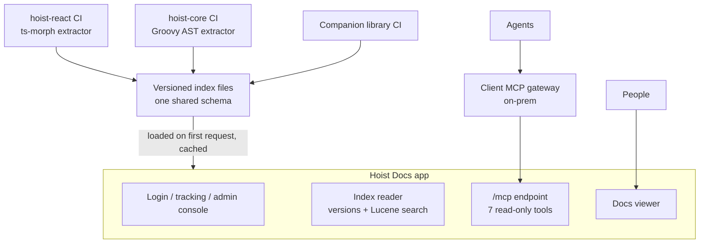

# Hoist Docs: unified MCP server and docs app

Design document. Source of truth while the project is under way; update it as decisions change.
Original draft and discussion: https://claude.ai/artifact/UAw4RnTApjAJTuCjJiRuyN

## Summary

Replace the two stdio MCP servers bundled with hoist-react and hoist-core, and the docs viewer in
Toolbox, with one Hoist application: **Hoist Docs** (this repo). It serves an MCP endpoint for
agents and a docs UI for people, both from versioned indexes built in each library's CI.

- **Why now:** an important client requires MCP servers to run through their gateway. Gateways
  front HTTP endpoints; ours speak only stdio. Bundling also puts six MCP-only packages into every
  Hoist app's dependency tree.
- **What changes:** hoist-react and hoist-core stop shipping any MCP runtime code. Each repo keeps
  only an index builder that runs in CI.
- **Two deployments, one codebase:** XH-hosted and an on-prem container behind the client's
  gateway.

## Decisions in force

| Topic | Decision |
| --- | --- |
| Language | Groovy server (Grails / hoist-core), TypeScript client (hoist-react), laid out like Toolbox |
| Search | Lucene, tuned to match today's hoist-react search pipeline |
| MCP auth | **Anonymous for now.** `/mcp` is whitelisted; calls are tracked with a fixed `mcp-anonymous` identity. Per-user auth (MCP OAuth, gateway modes) comes last. |
| Human auth | Same Auth0 / OAuth setup as Toolbox (`AuthenticationService`, `AuthZeroTokenService`, `oauthProvider` instance config). `NONE` for local dev. |
| Versions | Index per published version plus `develop`; never read Git per query |
| Offline | Not supported, not needed |
| Branches | `develop` in this repo; `hoist-docs` in hoist-react, hoist-core and Toolbox |
| CLI | `hoist-docs` CLI name kept; becomes a thin client of this service when the old servers retire |

## Current state

| Component | Where | Language and size | How it runs | Problems |
| --- | --- | --- | --- | --- |
| hoist-react MCP server and CLIs | `hoist-react/mcp/`, `bin/hoist-mcp.mjs` | TypeScript, ~11.6k lines incl. tests | stdio, `tsx` executes TS source at runtime | `@modelcontextprotocol/sdk`, `ts-morph`, `tsx`, `zod`, `commander`, `minisearch` are runtime `dependencies` of `@xh/hoist`, used only by `mcp/` and `bin/`. `mcp/` and `bin/` ship in the npm package. |
| hoist-core MCP server and CLIs | `hoist-core/mcp/`, artifact `io.xh:hoist-core-mcp` | Groovy, ~2.6k lines | stdio, fat jar via `mcp/bootstrap.sh` | `bootstrap.sh` downloads jars with `curl --ssl-no-revoke`, no integrity check. MCP Java SDK pulled in Jackson CVEs. Substring search, not ranked. |
| Toolbox docs viewer | `toolbox/src/main/groovy/io/xh/toolbox/docs/`, `DocsService`, desktop and mobile UI | Groovy + TS, ~2.1k lines | Part of Toolbox; downloads library tarballs from GitHub at startup | Third copy of registry and content-source code. Only the version Toolbox depends on. |
| Context7 | `hoist-core/context7.json` | External | Third party | No symbol tools, no ranking control, no visibility. |

The two MCP servers already mirror each other: the same seven tools (`hoist-*` / `hoist-core-*`)
and the same `docs/doc-registry.json` schema. The split exists only because symbol extraction needs
each language's own toolchain.

## Goals and non-goals

**Goals**

- Serve hoist-react, hoist-core and companion-library docs and symbols over MCP Streamable HTTP so
  any MCP gateway can front it.
- Ship no MCP runtime code or dependencies inside `@xh/hoist` or the hoist-core jar.
- One implementation for agents and people, replacing two MCP servers and the Toolbox viewer.
- Answer for any released version plus `develop`.
- Usage visible in the Hoist admin console.
- Keep tool names and output stable so existing agent setups and skills keep working.

**Non-goals**

- Offline use. Live reading of a developer's uncommitted checkout (beyond the viewer's local dev
  mode). Indexing application code. Any write operation.

## Architecture

## Index format and build pipeline

Each library builds one self-contained JSON index per release in CI, with its own toolchain. The
service only reads these files; it never parses source. The schema lives in
[`index-schema.md`](./index-schema.md).

- **Contents:** header (library, version, git SHA, build time, `schemaVersion`); doc registry
  entries; doc markdown and sections; symbols; members; precomputed symbol details.
- **Builders:** hoist-react `pnpm build:index` (reuses `ts-registry.ts`, `import-paths.ts`,
  `doc-sections.ts`); hoist-core Gradle task `:mcp:buildIndex` (reuses `GroovyRegistry`,
  `DocRegistry`).
- **Publishing:** attached to GitHub releases and published with the library; `develop` rebuilt on
  push. `schemaVersion` checked on load.

## Versioning

- Selection by optional `version` argument on each tool (or the viewer's version picker); default
  is the newest loaded version.
- Index sources, in order: a local index directory (`indexDir` instance config, used for dev and
  on-prem), then GitHub release assets (hosted).
- Tagged versions are cached indefinitely; `develop` refreshes on reload.

## MCP endpoint and tools

One stateless Streamable HTTP endpoint at `/mcp`, JSON-RPC 2.0 per POST, implemented directly in a
Hoist controller (no Java SDK dependency). Supports `initialize` for older clients and
`server/discover` for 2026-07-28 clients; no sessions.

| Tool | Arguments | Replaces |
| --- | --- | --- |
| `hoist-search-docs` | `query`, `library`?, `category`?, `limit`?, `version`? | `hoist-search-docs`, `hoist-core-search-docs` |
| `hoist-list-docs` | `library`?, `category`?, `version`? | `hoist-list-docs`, `hoist-core-list-docs` |
| `hoist-read-doc` | `id`, `section`?, `outline`?, `library`?, `version`? | `hoist-read-doc`, `hoist-core-read-doc` |
| `hoist-search-symbols` | `query`, `library`?, `kind`?, `limit`?, `version`? | `hoist-search-symbols`, `hoist-core-search-symbols` |
| `hoist-get-symbol` | `name`, `file`?, `library`?, `version`? | `hoist-get-symbol`, `hoist-core-get-symbol` |
| `hoist-get-members` | `name`, `filter`?, `file`?, `library`?, `version`? | `hoist-get-members`, `hoist-core-get-members` |
| `hoist-ping` | none | both pings; reports loaded versions |

- `library` is `react`, `core` or a companion id; omitted, results span all and are labelled.
- `hoist-core-*` names are accepted as aliases (scoped to `core`).
- All tools are annotated read-only.

## Docs viewer

Ported from Toolbox (`client-app/src/desktop/tabs/docs/`, `client-app/src/mobile/docs/`), backed
by the index reader, with a version picker and Lucene search. Behind Auth0 login, same as Toolbox.
Toolbox's Docs tab becomes a link here.

## Authentication

| Mode | Where | Status |
| --- | --- | --- |
| Anonymous MCP | `/mcp`, all deployments | **Now** |
| `AUTH_ZERO` (people) | Viewer, hosted | **Now**, copied from Toolbox |
| `NONE` | Local dev and CI | **Now** |
| MCP OAuth (`AUTH_ZERO` for agents) | `/mcp`, hosted | Later |
| `GATEWAY_TOKEN` / `GATEWAY_HEADER` | On-prem | Later |

Auth0 values (`auth0Config` soft config: domain, client ID, audience) and the app's URLs in the
Auth0 dashboard must be supplied by XH.

## Usage visibility

Each MCP call and viewer search writes a Hoist track entry (`category: 'MCP'` / `'Docs'`, tool
name, elapsed, library, version, result count, client). Query text is logged only when the
`logQueries` config is on.

## Code reuse and migration

| Existing code | Fate |
| --- | --- |
| hoist-react `ts-registry.ts`, `import-paths.ts`, `doc-sections.ts`, `doc-registry.ts` | Kept as the index builder |
| hoist-react `doc-search.ts`, `symbol-search.ts`, `search-text.ts`, `doc-id-resolver.ts`, `formatters/` | Behaviour ported to this app |
| hoist-react `server.ts`, `tools/`, `resources/`, `bin/hoist-mcp.mjs`, MCP-only dependencies | Removed |
| hoist-core `GroovyRegistry`, `DocRegistry` | Kept as the index builder |
| hoist-core `HoistCoreMcpServer`, `bootstrap.sh`, MCP SDK | Removed |
| Toolbox `DocsService`, `DocRegistry`, `ContentSource` classes, viewer UI | Moved here / removed |

**Phases:** 1. index format and builders; 2. service core; 3. on-prem release; 4. hosted service
and viewer; 5. retire old servers.

## Arguments against (summary)

Strongest: XH becomes a service operator; login friction (vendor docs servers are anonymous);
scope beyond the client's ask. Answered by ordering: on-prem first, anonymous MCP now, measure,
then decide on hosting and per-user MCP auth. Full table in the original draft.

## Open questions

- [ ] What exactly does the client's gateway do with identity?
- [ ] Who may log in to the hosted viewer?
- [ ] Does Auth0 support CIMD or automatic client registration for agents?
- [ ] Hosted at all, or on-prem only until demand shows?
- [ ] Log query text on the hosted service?
- [ ] How many past releases to bake into the on-prem image?
- [ ] Which companion libraries are in scope first?
