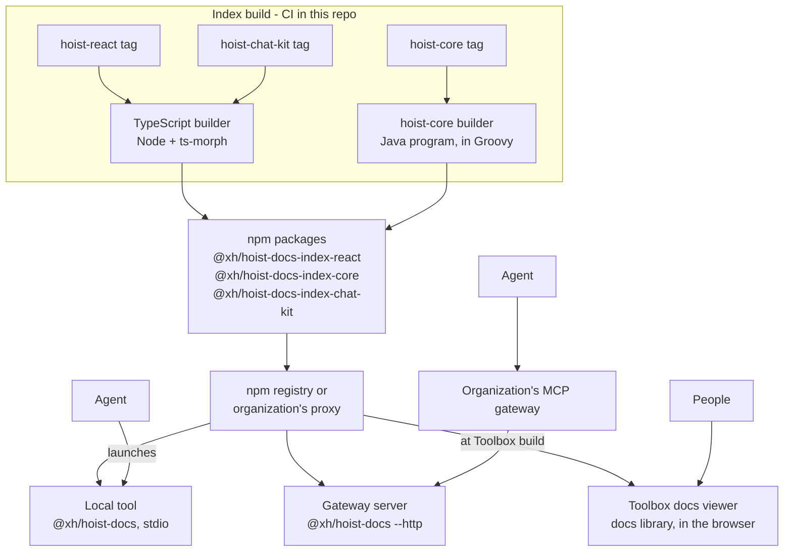

# Hoist Docs: Hoist documentation for agents and people

Design document. Source of truth while the project is under way; update it as decisions change.

## Summary

Replace the two stdio MCP servers bundled with hoist-react and hoist-core, and the docs backend in
Toolbox, with **Hoist Docs** (this repo):

- **A local MCP tool, `@xh/hoist-docs`.** Each Hoist app adds it as a dev dependency. The agent
  launches it over stdio, as it launches today's hoist-react server, and it answers for exactly
  the Hoist versions the app uses.
- **The same program as an HTTP server**, for organizations that front MCP servers with a
  gateway.
- **Versioned index files**, built in this repo from any release of hoist-react and hoist-core and
  published as npm packages, so they reach every team through the registry it already uses.
- **A browser-safe docs library** that Toolbox's docs viewer uses directly, with no server.

XH does not host a service. Everything runs on developers' machines, in Toolbox's browser, or on
an organization's own infrastructure.

- **Why now:** enterprise teams increasingly require MCP servers to run through an MCP gateway.
  Gateways front HTTP endpoints; ours speak only stdio. Bundling also puts six MCP-only packages
  into every Hoist app's dependency tree, and hoist-core's server needs a per-machine launcher for
  a fat jar.
- **What changes in the libraries:** hoist-react and hoist-core stop shipping any MCP or index
  code. They keep their docs and `docs/doc-registry.json`; everything else lives here.

**For an app developer, the change in `.mcp.json`:**

```jsonc
// Today: two servers, one per library; hoist-core's launcher is generated per machine.
{"mcpServers": {
  "hoist-react": {"command": "node", "args": ["client-app/node_modules/@xh/hoist/bin/hoist-mcp.mjs"]},
  "hoist-core": {"command": "./bin/hoist-core-mcp"}
}}

// With Hoist Docs: one server for both libraries, committed once.
{"mcpServers": {
  "hoist": {"command": "node", "args": ["client-app/node_modules/@xh/hoist-docs/bin/hoist-docs.mjs"]}
}}
```

## Why not a Hoist app

The first version of this repo was a Hoist application (Grails server, hoist-react admin client),
kept at the `grails-prototype` tag. It was dropped because, with every endpoint anonymous, the
Hoist stack carried far more than the service needs:

- The admin console was the main thing Hoist provided, and it needs authentication (it exposes
  configs and logs). Auth0 services, a user domain, a database, Hazelcast and a client build all
  existed only to support it.
- The service is stateless and read-only. A Grails app with a database is a heavy thing to run on
  every developer's machine or to hand an organization for its gateway.
- Being in Groovy forced a port of hoist-react's TypeScript search, held identical by a parity
  spec. In TypeScript the original search code is reused instead of ported.

## Components

One repo, four parts. Only the tool ever answers requests; the builders are command-line programs
that write a file and exit.

| Component | Where | Toolchain | Runs |
| --- | --- | --- | --- |
| **MCP tool** (`@xh/hoist-docs`) | `src/` | Node 24; runtime dependencies `@modelcontextprotocol/server` (MCP SDK v2) and `minisearch` | Developers' machines over stdio; an organization's server over HTTP |
| **Docs library** | `@xh/hoist-docs/docs` (`src/docs/`), a browser-safe entry point over the doc-side code in `src/index/` | Plain TypeScript | Toolbox's browser |
| **TypeScript builder** | `builders/react/` | Node, `ts-morph` | Index build time: CI here, or a developer's machine. Builds hoist-react, and the other TypeScript libraries with `--library` |
| **hoist-core builder** | `builders/core/` | A Java program, written in Groovy and run on a JDK; built and launched with a small Gradle build | Index build time: CI here, or a developer's machine |

The JVM and `ts-morph` are needed only where indexes are built, never where docs are served. The
npm package `@xh/hoist-docs` ships the tool and the docs library; builders stay out of it.

## Decisions in force

| Topic | Decision |
| --- | --- |
| Hosting | **None by XH.** The tool runs locally, or on an organization's own server behind its gateway. |
| Language and runtime | TypeScript on Node 24 LTS, pnpm. In development Node runs the source directly by stripping types, with no `tsx`. Node refuses to strip types inside `node_modules`, so the published package ships JavaScript compiled by `tsc` (`pnpm build`, run on pack); `bin/hoist-docs.mjs` launches it. Code is limited to erasable syntax (no enums, namespaces or parameter properties). |
| Transport | **stdio by default**: the agent launches the tool and talks over stdin and stdout, with no port. **HTTP with `--http`**, for gateways and development. Both serve the same server factory, through the SDK's `serveStdio` and `createMcpHandler`. In stdio mode all logging goes to stderr. |
| MCP | **The official MCP TypeScript SDK v2** (`@modelcontextprotocol/server`), which implements the **2026-07-28 spec** - stateless serving and `server/discover` - and still serves 2025-era clients through the `initialize` handshake (stateless over HTTP). v2 is published as separate packages; the single `@modelcontextprotocol/sdk` package is the v1 line, which stops at `2025-11-25`. The SDK owns protocol compliance, input validation against each tool's JSON Schema, and the transports; this repo owns the tools. |
| Installation | **A dev dependency of each app** (`@xh/hoist-docs` in `client-app/package.json`), with `.mcp.json` pointing into `node_modules`. Reproducible through the lockfile, reviewed and installed like every other dependency, no network needed to start it, and the same shape as today's hoist-react entry. `npx @xh/hoist-docs` is documented only for trying it out. |
| Versions | **The local tool serves the app's installed versions, and only those.** HTTP deployments can serve several versions, since one gateway server may front apps on different releases. |
| Search | hoist-react's existing search and formatter code, moved here and adapted to read index files. One ranking for every library, including hoist-core (previously substring search). |
| Index builders | **Live in this repo**, not in the libraries. A builder takes a library checkout at any tag, so a builder fix can be applied to every past release by rebuilding its index. |
| Libraries | **A table of built-in libraries** (`src/libraries.ts`): hoist-react, hoist-core and hoist-chat-kit. Every index is built here and published centrally, one package per library; the table drives version detection, fetching, labels, building and publishing. A new XH library is a row in the table. Libraries that ship their own index, for organizations' own libraries, are a direction, not built. See **Libraries**. |
| Index publishing | **npm packages**, one per library version: `@xh/hoist-docs-index-react@90.0.0`, `@xh/hoist-docs-index-core@45.0.0`. Organizations already pull `@xh/hoist` through their npm registry or proxy (e.g. Artifactory), so the indexes arrive by a route they already allow. |
| Index compatibility | Indexes hold extracted facts only; interpretation happens in the tool. Schema changes are additive by default; a breaking change ships with a load-time migration. See **Compatibility**. |
| Docs viewer | **Stays in Toolbox**, desktop and mobile, where docs link to live examples and back. Toolbox reads docs directly through the docs library and the index packages for its own Hoist versions; no server is involved. |
| Access | No authentication. Over stdio only the launching agent can reach the tool. Over HTTP, identity is the gateway's concern. |
| Usage tracking | Locally, nothing leaves the machine. Over HTTP, one structured JSON log line per call, for the organization's own log collection. Toolbox tracks docs searches with Hoist's activity tracking. |
| Configuration | Command-line flags and environment variables only. No database. |
| Offline | Not a goal, but once a version's indexes are cached the local tool needs no network. |
| Branches | `develop` in this repo; `hoist-docs` in hoist-react, hoist-core and Toolbox. |

## Current state

| Component | Where | Language and size | How it runs | Problems |
| --- | --- | --- | --- | --- |
| hoist-react MCP server and CLIs | `hoist-react/mcp/`, `bin/hoist-mcp.mjs` (removed on the `hoist-docs` branch) | TypeScript, ~11.6k lines incl. tests | stdio, `tsx` executes TS source at runtime, parsing the installed source with ts-morph | `@modelcontextprotocol/sdk`, `ts-morph`, `tsx`, `zod`, `commander`, `minisearch` are runtime `dependencies` of `@xh/hoist`, used only by `mcp/` and `bin/`. `mcp/` and `bin/` ship in the npm package. |
| hoist-core MCP server and CLIs | `hoist-core/mcp/`, artifact `io.xh:hoist-core-mcp` | Groovy, ~2.6k lines | stdio, fat jar via `mcp/bootstrap.sh` and a per-machine launcher | `bootstrap.sh` downloads jars with `curl --ssl-no-revoke`, no integrity check. MCP Java SDK pulled in Jackson CVEs. Substring search, not ranked. |
| Index builders | Moved here (`builders/`); the originals in `hoist-react/docs-index/` and `hoist-core/docs-index/` remain until phase 7 | TypeScript, Groovy | Run by hand; nothing publishes yet | Relocated builders give byte-identical output to the originals. |
| Toolbox docs viewer | Toolbox `DocsService`, desktop and mobile UI | Groovy + TS | Self-contained on `develop` (sibling checkouts or GitHub tarballs); on the `hoist-docs` branch, pointed at the now-removed `docs/*` HTTP API | To read docs directly instead, through `@xh/hoist-docs/docs` and `hoist-docs export-docs` (phase 5). |
| Context7 | `hoist-core/context7.json` | External | Third party | No symbol tools, no ranking control, no visibility. |

## Goals and non-goals

**Goals**

- Serve hoist-react, hoist-core and the other built-in libraries' docs and symbols to agents, over
  stdio
  locally and over MCP Streamable HTTP for gateways.
- Ship no MCP or index code or dependencies inside `@xh/hoist` or the hoist-core jar.
- One implementation for agents and people, replacing two MCP servers and Toolbox's docs backend.
- Answer for the versions an app actually uses, for any release from hoist-react v83 and
  hoist-core v37, plus `develop`.
- Reach Hoist teams through the registries they already use, so no new network access is needed.
- Keep tool names and output stable so existing agent setups and skills keep working.
- Light to run: fast startup, no install step beyond the dependency, nothing to keep running.

**Non-goals**

- An XH-hosted service. Live reading of a developer's uncommitted checkout. Indexing application
  code. Any write operation. An admin UI. Central usage reporting. (The last two kinds of
  reading are reconsidered for large apps under **Application docs and shared code**, a potential
  direction.)

## Architecture



## Local tool

The primary deployment. An app adds the tool once:

```jsonc
// client-app/package.json
"devDependencies": {"@xh/hoist-docs": "^1.0.0"}

// .mcp.json, at the project root
{"mcpServers": {
  "hoist": {"command": "node", "args": ["client-app/node_modules/@xh/hoist-docs/bin/hoist-docs.mjs"]}
}}
```

The `xh:onboard-app` skill writes both. When the agent starts the tool, it:

1. **Works out the versions** from the project root: the exact installed `@xh/hoist` version (from
   `client-app/node_modules/@xh/hoist/package.json`, not the range in `package.json`) and
   `hoistCoreVersion` from `gradle.properties`. A project with only one of them gets that library
   only.
2. **Gets the indexes**, if not already cached in `~/.cache/hoist-docs`: the two index packages
   for exactly those versions, the highest revision of each. Fetches go through npm itself
   (`npm pack`), so the developer's `.npmrc` registry, credentials, proxy and certificates apply
   unchanged. About 2 MB, once per version.
3. **Serves them over stdio** until the agent session ends. No port is opened.

After a Hoist upgrade, restarting the agent picks up the new versions and fetches their indexes
once. A rebuilt index for the app's version (a builder fix, published as a revision) is picked up
the same way, without upgrading Hoist.

**Snapshot versions.** An app on a `-SNAPSHOT` version, or Toolbox running hoist-react from a
sibling checkout, has no released index. The tool uses the `develop` index, or a local index
directory given with `--index-dir`, for example one built from that checkout with
`pnpm build:react`.

**Library checkouts.** Run in a checkout of hoist-react or hoist-core itself (recognized by
`package.json` naming `@xh/hoist`, or `settings.gradle` naming `hoist-core`), the tool serves the
`develop` index of both libraries: its own under the checkout's snapshot version, the other under
`develop`. The libraries' own `.mcp.json` launch it with `npx -y @xh/hoist-docs@^1`, since neither
installs it, and pass `HOIST_DOCS_INDEX_DIR` through as `INDEX_DIR` for locally built indexes.

## Libraries

Every library the tool serves is a row in one table, `src/libraries.ts`, which everything reads:
version detection, index fetching, display order and labels, the docs library, the builders and
the publishing script.

| Library | Id | Index package | Found in an app by | Builder | Indexed from |
| --- | --- | --- | --- | --- | --- |
| hoist-react (`@xh/hoist`) | `react` | `@xh/hoist-docs-index-react` | installed `@xh/hoist` | TypeScript | v83 |
| hoist-core (`io.xh:hoist-core`) | `core` | `@xh/hoist-docs-index-core` | `hoistCoreVersion` in `gradle.properties` | Groovy | v37 |
| hoist-chat-kit (`@xh/hoist-chat-kit`) | `chat-kit` | `@xh/hoist-docs-index-chat-kit` | installed `@xh/hoist-chat-kit` | TypeScript | v1 |

- **One pipeline for all.** Each library is indexed here, from its release tags and `develop`,
  published as its own index package, and fetched by the tool exactly as hoist-react's is. A
  builder fix reaches every past release through a rebuild.
- **The TypeScript builder serves every TypeScript library.** `--library <id>` sets the id, the
  import prefix (`@xh/hoist-chat-kit/core`), and folders that hold no published source (`test/`).
  hoist-react's output is unchanged, byte for byte. A library's agent guidance, the
  `mcpInstructions` of its `docs/doc-registry.json`, goes into its index header and from there
  into the server instructions; hoist-react's guidance is the server instructions themselves.
- **Optional libraries.** hoist-chat-kit is served only to an app that installs it, and never
  defaults to `develop` in another library's checkout. If its index cannot be found, the tool
  skips it with a warning and still serves hoist-react and hoist-core; for those two a missing
  index is an error.
- **Adding a library:** a row in the table, a golden set in `test/golden/`, and a trusted
  publisher for its index package. The library itself needs only its docs and a
  `docs/doc-registry.json`, in hoist-react's format. Nothing changes in its release process.

### Libraries that ship their own index (direction)

Not built. For libraries XH does not build, such as an organization's own React library, the
central pipeline cannot work: XH cannot build from private repos. Such a library would build its
index when it packs, include it in its npm package and name it in its `package.json`
(`"hoistDocs": {"index": "hoist-docs/index.json.gz"}`), and the tool would find it among an app's
installed dependencies, with no fetch and always the installed version. It would need the
TypeScript builder published as a package for library authors (`@xh/hoist-docs-builder`), rules
for ids and collisions, and a rule that an index's `instructions` reach the agent only from `@xh`
packages, so that a dependency cannot steer the agent. Such indexes cannot be backfilled: a
builder fix reaches a library only at its next release. JVM libraries (Grails plugins) have no
`node_modules` to search and would need another route. The worked example would be XH's template
package for code shared across client apps (`@xh/package-template`), shaped like an
organization's own library. To be taken up when an organization asks.

## Application docs and shared code (potential direction)

Not decided: a direction for large applications, to be tried on one before it is designed in
detail. It loosens the non-goals "indexing application code" and "live reading of a developer's
uncommitted checkout", for the local tool only.

**The application's own docs.** Large apps keep their own `docs/`: architecture, conventions,
runbooks, domain guides. With a `docs/doc-registry.json` at the project root, in the format the
Hoist libraries use, the local tool would serve them as one more library, read live from the
working tree at startup the way `export-docs --from-checkout` reads the libraries (about 0.15 s),
and again on change. The id comes from `xhAppCode` in `gradle.properties`
(`trading:docs/pricing.md`). Nothing is built or published, so they never go stale. This is the
low-risk first step.

**The application's shared code, opt-in.** In a very large app, an agent working on one module can
read all the code but does not know what exists, and rewrites helpers, models and services the app
already has. Concept search over shared code's symbols and doc comments, as hoist-react gets, is
what grep and name-based code navigation do not give. The app would name its shared folders and
install the builder:

```jsonc
// client-app/package.json
"hoistDocs": {"app": {"sources": ["src/shared", "src/common"]}},
"devDependencies": {"@xh/hoist-docs-builder": "..."}
```

- The tool builds the index in the background at startup, cached per file so later starts rebuild
  only what changed, and serves Hoist's docs meanwhile. Without the builder installed there is no
  app index, so the tool itself never carries `ts-morph`.
- Shared folders only: the module being worked on is read directly by the agent.
- Client-side TypeScript only at first. Server-side shared code would need the JDK builder at
  startup, as Grails plugins would.

**Before building it**, test the premise on one large app: give an agent tasks that should reuse
shared code and see whether it misses it, then repeat with the shared folders indexed by hand
(today's builder, adapted). If agents already find it, this is not worth building.

## Gateway deployment

For organizations that front MCP servers with a gateway, the same package runs as an HTTP
server: `hoist-docs --http`, or the `Dockerfile` image (`node:24-slim`). It can serve several
versions of each library, since one server may front apps on different releases. Agents pass
`library` and `version` to select one; the newest is the default.

**Built-in libraries on demand.** With no index directory given, the server fetches what agents
ask for, as the local tool does: through npm and the server's own `.npmrc`, so the
organization's registry and credentials apply, cached in `HOIST_DOCS_CACHE`. At startup, and at
most hourly after, it fetches the newest release of each built-in library (the index package's
`latest` tag); a call naming `library` and `version` fetches that release on first use. Nothing
needs filling or updating by hand, and a new Hoist release is served once its index is published.
A failed fetch is retried after five minutes. A directory of index files (`INDEX_DIR`) remains
for servers without registry access. An application's own docs and shared code (above) are not
served by a gateway: a gateway has no developer's checkout.

## Toolbox docs viewer

Toolbox's desktop and mobile viewers stay in Toolbox, so docs keep their links to live examples
and back. They read docs directly, with no server, through `@xh/hoist-docs/docs`.

**Why Toolbox uses this library, rather than its own docs code.** Toolbox `develop` is
self-contained today: about 390 lines of Groovy read docs from sibling checkouts in development
and download each library's source tarball from GitHub at startup otherwise, and about 310 lines
of client code build a simple whole-document search. Using the library instead:

- **Treats both libraries the same way, through the route agents use.** hoist-react's docs do
  ship in the `@xh/hoist` npm package, but hoist-core's reach Toolbox only through Gradle, which
  carries no docs. Index packages give both libraries one route, npm, at Toolbox's exact versions,
  rather than npm for one and something else for the other.
- **Gives the viewer the MCP tools' search**: section-level results with excerpts, the tuned
  ranking the golden sets check, the same answers agents get. About 800 of the library's 970 lines
  are the code behind `hoist-search-docs`.
- **Removes Toolbox's server-side docs code**, including the GitHub download at startup, a
  runtime dependency that can fail and slows startup.
- **Keeps one owner** for doc registry and section parsing, instead of a copy in Toolbox.

**How it works:**

- **Library:** `DocsCatalog` takes one docs payload per library and answers `registry()`,
  `content(source, docId)` and `search(query, limit)`, in the shapes Toolbox's viewer already
  reads (those of the former `docs/*` HTTP API), so its code changes little. Building the search
  index takes about 140 ms for hoist-react and 80 ms for hoist-core; a query takes a few
  milliseconds. A spec checks that nothing it imports reaches Node.
- **Data for builds:** `hoist-docs export-docs --out <dir>`, run in Toolbox's build, resolves
  Toolbox's own Hoist versions as the local tool does and writes `<dir>/react.json`,
  `<dir>/core.json` and an `index.json` listing them. Each payload is the docs part of an index,
  small next to the full index, whose bulk is symbols: hoist-react's is 1.2 MB (371 KB gzipped)
  of 11.7 MB, hoist-core's 0.7 MB (210 KB gzipped). Loaded when the docs tab opens.
- **Data for doc authors:** `hoist-docs export-docs --out <dir> --from-checkout ../hoist-react
  --from-checkout ../hoist-core` reads docs straight from checkouts: the docs part of an index is
  only `doc-registry.json` plus the markdown it lists, so this needs no install, ts-morph or JVM,
  and takes about 0.15 s for both libraries. Toolbox runs it in local development, and with
  `--watch` it rewrites the payloads on every doc change, so edits show up on a reload of the
  viewer, as with the sibling-checkout reading Toolbox had before. It applies each builder's rules
  and gives the same payload as the builders for the same checkout, checked against real checkouts
  of both libraries.
- **Versions:** the viewer covers the versions Toolbox runs, which match the live examples beside
  it.
- **Tracking:** loading the docs runs in a telemetry span. Searches are not activity-tracked: the
  viewers search as the user types, debounced by only 200 ms, so each would log nearly every
  pause in typing.

Toolbox's server-side `DocsService` goes away. This repo's `docs/*` HTTP API, which existed only
for Toolbox to call a hosted service, is removed.

**In Toolbox** (`hoist-docs` branch): `client-app/scripts/export-docs.mjs` (`pnpm docs`, run by
`start`, `startWithHoist` and `build`) writes the payloads to `client-app/public/hoist-docs/`,
served at `/public/hoist-docs/`; from sibling checkouts when present, else the published docs for
Toolbox's versions. `pnpm docs:watch` is the authoring loop. `DocService` loads the payloads into
a `DocsCatalog` and keeps its API, so the viewers barely change; the version picker is gone, since
the viewer now holds one version per library. Its `.mcp.json` runs the local tool over stdio.

- **Command name collision.** Released `@xh/hoist` versions ship an older CLI also named
  `hoist-docs`, which can take the `node_modules/.bin/hoist-docs` slot. Anything that runs the
  tool from an app should use the package's own launcher,
  `node_modules/@xh/hoist-docs/bin/hoist-docs.mjs`, as the `.mcp.json` entry and Toolbox's script
  do. The collision ends for apps once hoist-react drops its CLI (phase 7).
- **Until `@xh/hoist-docs` is published**, Toolbox links it from a sibling checkout
  (`link:../../hoist-docs`, built with `pnpm build`), so Toolbox's CI cannot build the branch.
  The link becomes a version range at the first release.

## Index format and build pipeline

One self-contained JSON index per library version. The tool only reads these files; it never
parses source. The schema lives in [`index-schema.md`](./index-schema.md).

- **Contents:** header (library, version, git SHA, build time, `schemaVersion`); doc registry
  entries with full markdown; symbols with signatures, docs and members; the member index.
- **Inputs from each library:** its source, its docs, and `docs/doc-registry.json` (each doc's
  title, categories, description, keywords). The registry exists from hoist-react v83 and
  hoist-core v37 (both March 2026), and from hoist-chat-kit's first release; those are the oldest
  releases indexed.
- **Builders:** `builders/react/` (`pnpm build:react`), run with Node and `ts-morph`, for every
  TypeScript library (`--library chat-kit`); and
  `builders/core/` (`pnpm build:core`), a Java program written in Groovy (about 1,050 lines),
  built with Gradle, whose only dependencies are `groovy` and `groovy-json`. Each takes
  `--root <checkout>` and `--version <v>` and writes one index file. For the same checkout, each
  writes exactly what the original in-library builder wrote, apart from the build time.
- **What building a tag needs:**
  - The version comes from the tag, not the checkout. Tagged commits carry the *next* snapshot
    version (hoist-react's v89.3.1 tag says `90.0.0-SNAPSHOT`; hoist-core's v44.0.0 says
    `44.0-SNAPSHOT`), the release version being set at publish time.
  - hoist-react needs its dependencies installed at that tag, for type resolution, with the
    package manager the tag declares: Yarn through v86, pnpm later (`corepack` picks it).
    hoist-core needs no install; its builder reads source files only.
  - Both must understand the source layout of every release from the floor onward. Releases
    before the move carry the old `mcp/` server source, which the hoist-react builder excludes
    (the hoist-core builder reads only its source folders). Checked by building hoist-react
    v83.0.0 and hoist-core v37.0.0, the oldest in range, with today's builders.
- **Release flow:** `.github/workflows/publish-indexes.yml` runs `scripts/publish-indexes.ts`
  daily: for each release tag from the floor with no published index, it checks the library out
  at the tag in a git worktree, installs (hoist-react only), runs the builder with the tag's
  version, packs the index (`scripts/pack-index.ts`) and publishes it; then the same for
  `develop` if its head changed. Run by hand, it takes specific tags, rebuilds them as new
  revisions, or does a dry run that builds and packs without publishing. Nothing changes in the
  libraries' own release processes.
- **Publishing needs:** npm trusted publishing (OIDC), as hoist-react's releases use, with a
  trusted publisher configured on npmjs.com for each index package; and the
  `FONTAWESOME_PACKAGE_TOKEN` secret, since installing any hoist-react release pulls Font Awesome
  Pro from its private registry. The dist-tag `latest` only moves forward; older releases
  published later get `backfill`.
- **Packages:** `@xh/hoist-docs-index-react`, `@xh/hoist-docs-index-core` and
  `@xh/hoist-docs-index-chat-kit`, each holding one gzipped index, versioned to match the library release. npm versions are immutable, so a rebuilt
  index for an existing release publishes as a revision (`90.0.0-r2`); consumers take the highest
  revision for a release. `develop` builds publish as prerelease versions under a `develop`
  dist-tag.
- **Backfill:** after a builder fix, rebuild and republish every release from the floor onward.

## Compatibility

Published indexes are permanent: `react-90.0.0` must stay readable as the tool changes.

- **Facts, not interpretation.** Indexes hold what is extracted from source: markdown, symbols,
  signatures, members. Everything derived from those is computed by the tool at load or query
  time: doc sections, search indexes, ranking, output text, doc id shortcuts. Most changes, from
  ranking tuning to new tools, never touch the index.
- **Additive by default.** A new field is optional, and the tool copes when it is missing, as it
  already does for `memberNames` and `hint`. Additive changes keep `schemaVersion`.
- **Breaking changes migrate.** When a format change cannot be additive, `schemaVersion` bumps and
  the tool gains a load-time upgrade from the previous version. Migrations stay as long as
  releases indexed under the old schema are supported, so old indexes never need rebuilding to
  keep working.
- **Rebuilding as the fix for extraction gaps.** When a builder misses something (hoist-core's
  member index, see **Testing**), the fix is a builder change plus a backfill, not a tool
  workaround.
- **Tool and Hoist versions.** Apps pin the tool through their lockfile, so an old tool can meet
  an index from a newer Hoist release. The tool reads every schema version it knows and refuses a
  newer one with a clear "upgrade `@xh/hoist-docs`" message. A Hoist release that needs a newer
  tool says so in its upgrade notes, with the minimum version.

## MCP tools

Seven read-only tools, with the names and output of the stdio servers they replace. Docs are also
served as resources, from the template `hoist://docs/{+id}` (`+`, since doc ids contain slashes).
Served by the MCP SDK v2: the 2026-07-28 protocol, opening with `server/discover`, and the
2025-era `initialize` handshake for older clients, over both stdio and HTTP. Tests drive both eras
over both transports with the SDK's own client.

| Tool | Arguments | Replaces |
| --- | --- | --- |
| `hoist-search-docs` | `query`, `library`?, `category`?, `limit`?, `version`? | `hoist-search-docs`, `hoist-core-search-docs` |
| `hoist-list-docs` | `library`?, `category`?, `version`? | `hoist-list-docs`, `hoist-core-list-docs` |
| `hoist-read-doc` | `id`, `section`?, `outline`?, `library`?, `version`? | `hoist-read-doc`, `hoist-core-read-doc` |
| `hoist-search-symbols` | `query`, `library`?, `kind`?, `includeInternal`?, `detail`?, `limit`?, `version`? | `hoist-search-symbols`, `hoist-core-search-symbols` |
| `hoist-get-symbol` | `name`, `filePath`?, `kind`?, `library`?, `version`? | `hoist-get-symbol`, `hoist-core-get-symbol` |
| `hoist-get-members` | `name`, `filter`?, `filePath`?, `include`?, `memberKind`?, `detail`?, `library`?, `version`? | `hoist-get-members`, `hoist-core-get-members` |
| `hoist-ping` | none | both pings; reports loaded versions |

- `library` is a built-in library's id (`react`, `core`, `chat-kit`); omitted, results span all
  and are labelled.
- `version` matters only on a multi-version gateway server. The local tool has one version per
  library, and its instructions do not ask the agent to choose.
- The old `hoist-core-*` tool names are not served. MCP clients prefix tool names with the server
  name, which changes from `hoist-core` to `hoist-docs` anyway, so an old reference would not
  resolve whatever this server did; registering aliases would only add six duplicate tools to
  every agent's list. Pass `library: "core"` instead.

## Code sources

| Existing code | Fate |
| --- | --- |
| hoist-react `mcp/data/search-text.ts`, `doc-sections.ts` | Moved here unchanged (`src/index/`) from the last hoist-react commit that had them, `788f56b3d` |
| hoist-react `mcp/data/doc-search.ts`, `symbol-search.ts` | Moved here as `DocSearch` and `SymbolSearch`, with the same MiniSearch configuration and tuning, reading index files instead of a live ts-morph registry. Each library has its own search index; results from several libraries merge by score |
| hoist-react `mcp/formatters/`, `doc-id-resolver.ts`, `instructions.ts` | Output shapes kept, via the `grails-prototype` code that had already adapted them to index files (`DocTools`, `SymbolTools`, `DocIdResolver`, `McpService`) |
| `grails-prototype` `McpService` (hand-written JSON-RPC) | Ported, then replaced by the MCP SDK v2 once its 2026-07-28 support was found (it ships as `@modelcontextprotocol/server`, not as `@modelcontextprotocol/sdk` 2.x) |
| `grails-prototype` `DocsController` | Ported as `docs-api.ts`, then removed with the `docs/*` API; its response shapes live on in `DocsCatalog` |
| hoist-react `docs-index/` (`ts-registry.ts`, `doc-registry.ts`, `import-paths.ts`, `build-index.ts`) | Moved here as `builders/react/`, taking the checkout as an argument; to be removed from hoist-react in phase 7 |
| hoist-core `docs-index/` (`GroovyRegistry`, `DocRegistry`, `IndexBuilder`) | Moved here as `builders/core/`, with its own Gradle build; to be removed from hoist-core in phase 7 |
| hoist-react `server.ts`, `resources/`, `bin/hoist-mcp.mjs`, MCP-only dependencies | Removed from hoist-react |
| hoist-core `HoistCoreMcpServer`, `bootstrap.sh`, MCP SDK | Removed from hoist-core |

## Testing

Tests run against small synthetic index files (`test/fixtures.ts`), plus real indexes checked in
under `test/fixtures/indexes` (hoist-react at `788f56b3d`, hoist-core at `279d3e9`, 1.9 MB
gzipped together).

Each library has a golden set (`test/golden/`): realistic queries, each naming the doc sections
or symbols a person would want, with expectations taken from the docs and API rather than from
search output. As in hoist-react's former specs, a case is a hit when an expected result is in the
top 3, each library must reach an 85% hit rate for doc search and for symbol search, and default
search output must stay under a token ceiling. hoist-react's set (79 doc and 82 symbol queries) is
carried over verbatim from its old specs; hoist-core's (50 doc, 59 symbol) is new. Current rates:
hoist-react 97.5% docs, 100% symbols; hoist-core 96.0% docs, 98.3% symbols.

The hoist-core builder used to member-index a curated 17 classes and set no `memberNames`, so exact
method names on services (`withSpan`, `sendEmail`, `pushToAllChannels`) found at best the owning
class, and hoist-core symbol search scored 93.2%. It now indexes the non-private members of every
type, as hoist-react's does, and records each symbol's own member names, minus those of the base
types most classes extend (`BaseService`, `BaseController`, `LogSupport`, `IdentitySupport`).
Protected members are included: they are the API apps use from their own subclasses
(`BaseController.renderJSON`). hoist-core symbol search now scores 98.3%, and the member cases
run without an owning-class fallback. Published indexes for past releases get the fix through a
backfill.

A parity spec checks that search still ranks exactly as hoist-react's did: fixtures in
`test/fixtures/parity` hold hoist-react's results for its golden-set queries, computed against the
checked-in hoist-react index. It runs with every `pnpm test` and matches every doc and symbol
case, scores included.

The builders' specs moved with them: hoist-react's import-path spec always runs, and its schema
conformance spec runs when `HOIST_REACT_ROOT` names a checkout with dependencies installed. CI is
to build indexes from the libraries' current `develop` to catch layout changes early. The stdio
transport gets a spec that launches the tool and makes calls over stdin and stdout.

## Configuration

| Setting | Default | Meaning |
| --- | --- | --- |
| `--http` | off | Serve HTTP instead of stdio. |
| `--project` | current directory | The project whose Hoist versions the local tool serves. |
| `PORT` / `--port` | `8081` | HTTP port. |
| `INDEX_DIR` / `--index-dir` | None: the local tool fetches the project's versions, HTTP fetches on demand | Directory holding `<library>-<version>.json[.gz]` files, e.g. `react-90.0.0.json.gz`. Given (an empty `INDEX_DIR` counts as not given), the tool serves what is there and fetches nothing - e.g. locally built indexes before any are published, or a server without registry access. `pnpm start` and `pnpm dev` pass `./indexes`. |
| `HOIST_DOCS_CACHE` | `~/.cache/hoist-docs` (`%LOCALAPPDATA%\hoist-docs\cache` on Windows) | Where fetched indexes are kept, by the local tool and an HTTP server fetching on demand. |
| `LOG_QUERIES` | `false` | Include query text in usage log lines. |
| `ALLOWED_ORIGINS` | none | HTTP: comma-separated browser origins allowed besides localhost. |
| `LOG_LEVEL` | `info` | `debug` for more detail. |

## Phases

1. Index format and builders in hoist-react and hoist-core (done).
2. Tool core: scaffold, index loading, search code moved in, MCP over HTTP, tests (done).
3. Builders move here, with their specs (done); hoist-core builder fix for members (done); index
   publishing workflow and scripts (done, verified by dry runs for hoist-react v90.0.0,
   hoist-core v44.0.0 and hoist-core `develop`). First versions published by hand on 2026-11-10
   (`@xh/hoist-docs-index-react@90.0.0`, `@xh/hoist-docs-index-core@44.0.0`), with the publish
   workflow disabled until go-live. To go live: trusted publishers on npmjs.com, the Font Awesome
   secret, then re-enable the workflow for a first run that publishes every release from the
   floor and `develop`.
4. Local tool: stdio transport (the default), version detection, index fetching through npm and
   the cache, packaging and the release workflow (done, verified by installing the packed package
   into an app and running it through `.mcp.json`'s path against real index packages, and again
   from npm with `1.0.0-rc.1`). To go live: `v1.0.0`; `xh:onboard-app` writes the dev dependency
   and `.mcp.json`.
5. Toolbox reads docs directly: the docs library, `export-docs` with `--from-checkout` and
   `--watch`, and removal of this repo's `docs/*` API (done); in Toolbox, the export step, the
   `DocService` change, removal of the server's `DocsService` and the switch of `.mcp.json` to the
   local tool (done on Toolbox's `hoist-docs` branch, linking this repo until it is published).
6. Gateway deployment documented and released (`--http`, the image).
7. Retire the old servers and Context7; remove `docs-index/` from hoist-react and hoist-core.
8. Libraries: the table of built-in libraries, with hoist-chat-kit as the third (the TypeScript
   builder's `--library`, version detection, labels, publishing, its golden set and checked-in
   index); an HTTP server fetching built-in indexes on demand (done, verified by dry runs for
   hoist-chat-kit v1.0.0 and `develop` and for hoist-react v83.0.0, and by a gateway run against
   the published indexes). To go live: a trusted publisher for `@xh/hoist-docs-index-chat-kit`
   and its first publish by hand. In hoist-chat-kit (`hoist-docs` branch): `.mcp.json` and agent
   docs moved to the local tool.

## Arguments against (summary)

- **No central view of usage.** Without a hosted service XH cannot see how agents use the docs.
  Accepted: gateway deployments log usage for their organizations, and Toolbox tracks docs
  searches with Hoist's activity tracking.
- **A new dependency in every app.** Dev-only: five packages, about 18 MB installed, most of it the
  MCP SDK v2 and `zod`. It replaces the six MCP-only packages that `@xh/hoist` carries today as
  runtime dependencies, `ts-morph` and `tsx` among them.
- **A JVM in this repo's CI**, to run the hoist-core builder. Confined to index build time.
- **Every library is built here.** A new XH library is a row in the table, a CI build and an
  index package. Fine for a handful of XH libraries; organizations' own libraries would need the
  direction under **Libraries that ship their own index**.
- **Index publishing becomes a release dependency.** Toolbox, and any app wanting docs for a new
  release, waits for that release's index package. The release workflow keeps this to minutes.

## Open questions

- [ ] What do MCP gateways in use do with caller identity?
- [ ] Do registry proxies in use (e.g. Artifactory) pass the whole `@xh` npm scope, or an
  allow-list that would need `@xh/hoist-docs` and the index packages added (one pattern:
  `@xh/hoist-docs*`)?
- [ ] How does the release workflow notice new library tags: a scheduled check here (nothing
  needed in the libraries), or a dispatch from each library's release workflow (needs a token
  there)?
- [x] Package names? `@xh/hoist-docs`, `@xh/hoist-docs-index-react` and `@xh/hoist-docs-index-core`:
  one `hoist-docs` prefix, so the packages group together and a registry allow-list needs one
  pattern. npm cannot configure a trusted publisher for a package that does not exist yet, so each
  package's first version is published by hand; CI publishes everything after that.
- [ ] Toolbox's viewer: only the versions Toolbox runs, or a few past releases too?
- [x] Snapshot versions in the local tool? The `develop` index; a library checkout is recognized
  and gets both libraries' `develop` indexes. A local build is opt-in, through `INDEX_DIR`.
- [ ] If gateway deployments turn out to be per-developer too, drop multi-version support?
- [x] How do libraries beyond hoist-react and hoist-core get indexes? XH's are built-in libraries,
  built and published here (see **Libraries**); hoist-chat-kit first. Libraries that ship their
  own index are a direction, for organizations' own libraries.
- [ ] Organizations' own libraries: when one asks, build the shipped-index direction? JVM
  libraries (Grails plugins) would need their own route.
- [ ] Application docs and shared code: worth it? Test on one large app first (see **Application
  docs and shared code**).
- [x] Hosted by XH? No.
- [x] Make `xh/hoist-docs` public? Yes, done.
- [x] Local tool transport? stdio by default, HTTP opt-in.
- [x] Local tool installation? A dev dependency of each app.
- [x] Does the MCP SDK support the 2026-07-28 spec? Yes, in v2 (`@modelcontextprotocol/server`
  2.4.0) - the tool is built on it. The v1 package `@modelcontextprotocol/sdk` (1.32.2) does not.
